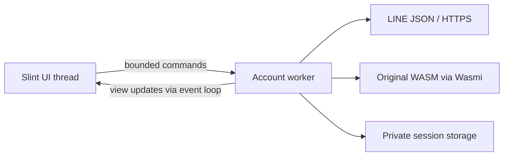

# Desktop app sketch

## Product goals

A small, quiet messaging client: fast startup, CPU rendering, low idle memory,
and dependable Japanese input. Slint is the chosen GUI toolkit. Keep the
original LINE crypto blob behind the existing Rust host.

The first window has a searchable conversation list, a message history, and a
multiline composer. Use ordinary text, flat colors, and restrained spacing.
Avoid animated backgrounds, blur, shadows, and continuously running timers.
The current implementation is an offline sketch with synthetic conversations
and drafts held in memory. No account integration or message sending is wired.

## Rendering and input decision

Pin Slint and slint-build to 1.18.1. Disable default features and enable `std`,
`compat-1-18`, `backend-winit`, `renderer-software`, and `accessibility`.
Select `winit` + `software` programmatically and fail if unavailable. Slint
documents CPU rendering through this backend/renderer combination, and separate
Wayland/X11 feature flags if a smaller platform-specific build is needed.
[Backend docs](https://docs.slint.dev/latest/docs/slint/guide/backends-and-renderers/backend_winit/),
[feature definitions](https://docs.rs/slint/1.18.1/slint/docs/cargo_features/index.html).

Use Slint's standard `TextEdit` for the composer and `LineEdit` for search. Do
not replace input widgets with drawn text or intercept composition keys. Enter
currently belongs entirely to the multiline editor/IME; Send is a separate,
disabled button. A click on the already-selected conversation does not reset
the editor. Committed drafts are saved when switching conversations, rather
than rewriting the editor's text on each keystroke.
[TextEdit reference](https://docs.slint.dev/latest/docs/slint/reference/std-widgets/views/textedit/).

Winit-backed Slint has preedit and commit handling; this is a capability, not a
guarantee of perfect IME behavior across input methods and compositors.
The local desktop is Wayland with Fcitx5 available. Treat the checks below as a
release gate. Automated layout snapshots do not satisfy that gate.

## IME acceptance checks

Record compositor, scale factor, input method engine, Slint version, and result.
Test native Wayland first and X11 separately. Run with Japanese fonts installed.

| Scenario | Required behavior | Status |
| --- | --- | --- |
| Type Japanese, convert, select a candidate, press Enter | One committed insertion, no accidental send/newline | Pending |
| Cancel composition with Escape | Preedit cancels; committed draft remains | Pending |
| Reconvert or replace selected text; move within composition | Correct cursor, selection, and surrounding text | Pending |
| Candidate popup near bottom/right edge, at 100%/150%/200% scale | Popup follows caret and stays usable | Pending |
| Focus search, composer, another window, and back mid-composition | No stuck preedit, duplicate text, or loss of committed draft | Pending |
| Click the selected chat during composition | No app-driven editor replacement | Pending |
| Switch conversations and return | Committed drafts stay attached to their conversation | Pending |
| Mixed kana/kanji, Latin, emoji, multiline text, selection, paste, undo | Correct display, editing, and cursor placement | Pending |
| Enter after a trailing newline, scroll long drafts | Last empty line and caret remain visible | Pending |

If a toolkit defect blocks any check, reduce it to a standalone reproduction
before building more messaging features. An alternative Slint backend can be
evaluated then; keep CPU rendering and IME quality as requirements.

## Planned boundary between GUI and protocol

This integration is planned. The sketch does not yet depend on the protocol
crate. First move the CLI's transport, session, and message-decryption code into
library modules without changing its verified behavior. Keep the CLI as a
diagnostic frontend to the same library.

The GUI thread owns Slint models and text editing. One account worker owns its
WASM runtime, tokens, key caches, and HTTPS requests. Do not move a Wasmi store
between threads or perform curl/network work on the GUI thread. Use a bounded
command queue, publish plain view data through `invoke_from_event_loop`, and
discard a runtime after a WASM exception. Coalesce model updates; never ship
private keys or credentials to the UI.

Start with the verified system-curl transport behind a Rust interface. A later
in-process transport can replace it after authentication/signature regression
checks. Do not add Tokio, a browser process, JavaScript, or a database to draw
the first window. Long polling and cancellation need deliberate scheduling so
they cannot block user commands or clean shutdown.

## Memory and responsiveness budget

These are initial engineering targets, not measured claims: an idle desktop
sketch below 80 MiB RSS at 980×720, near-zero idle CPU, and a usable window within
one second of a warm launch. Revisit with measurements on the target desktop.
The integrated account worker needs a separate budget after measuring the real
WASM heap and chat caches.

An initial local Wayland desktop smoke on 2026-10-15, using the release build and
default 980×720 requested size, measured 38,768 KiB RSS (37.9 MiB), 23,867 KiB PSS
(23.3 MiB), and 0.4% CPU over a five-second idle sample after a three-second
settling period. No `/dev/dri` or `/dev/nvidia` file descriptors were open. The
compositor's effective scale factor was not captured, so this is a preliminary
sample, not a cross-machine benchmark. The preview closed cleanly after the
smoke. Japanese composition has not been manually verified.

At 980×720, a single 32-bit pixel buffer costs about 2.7 MiB. More buffers,
HiDPI, font caches, accessibility, WASM memory, and decoded images add to this.
Measure RSS and PSS after first paint and again after opening chats, composing
Japanese, and leaving the app idle. Record window dimensions and scale factor
with each result. A headless snapshot is not an idle desktop memory measurement.

Use `ListView` for the conversation list. The sketch's short message list uses
`ScrollView`; replace it with a virtualized, paged history before loading real
history. Bound retained messages, decrypted media, image dimensions, and key
caches. Decode thumbnails on demand; release images when evicted. Add no busy
polling loop for UI refresh.

## Delivery sequence

1. Finish the input and rendering acceptance checks; measure the empty shell.
2. Extract the verified protocol library; connect saved-session status off the UI
   thread, with explicit loading/error/account-expired states.
3. Load bounded chat pages and decrypt text, preserving opaque API MIDs and key
   IDs. Display real conversation names only in the app.
4. Add `fetchOps`, deduplication, paging, and reconnection. Implement token refresh
   before promising persistent sign-in.
5. Add explicit encrypted text sending, with a separate Send action and clear
   pending/sent/failed states. Never send on an IME commit.
6. Add desktop identity, tray, notifications, and opt-in autostart. Then media
   download/decryption and bounded thumbnail caches.

Private state stays out of Git and diagnostics. Before distributing the app,
choose the project's license and the applicable Slint license, and resolve how
users obtain the proprietary crypto artifact; the current repo does not bundle it.
