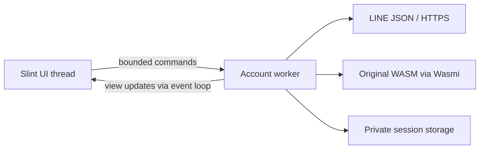

# Desktop app sketch

## Product goals

A small, quiet messaging client: fast startup, CPU rendering, low idle memory,
and dependable Japanese input. Slint is the chosen GUI toolkit. Keep the
original LINE crypto blob behind the existing Rust host.

The first window has a searchable conversation list, a message history, and a
multiline composer. Use ordinary text, flat colors, and restrained spacing.
Avoid animated backgrounds, blur, shadows, and continuously running timers.
The default application now opens the saved account, loads real chat metadata,
decrypts recent history, and displays cached assets. Drafts and unresolved
submissions persist in encrypted, account-scoped private state under the XDG
state directory. Explicit legacy/custom session paths retain their configured
state location.
`--demo` and `--snapshot` use synthetic conversations without account access.

## Everyday usability gate

The current sketch is a PoC, not ready for daily use. The user's issue list is
non-exhaustive; audit interaction sequences and asynchronous state changes as
well as appearance. See the reference map's everyday-use requirements for
per-message send/server-confirmation/read states, selection/copy, preview
hierarchy, and content-aware image/sticker backgrounds. A successful send call
is not a read receipt. Implementation and verification status, including partial
behavior and toolkit deviations, is recorded in ux-acceptance.md.

## Rendering and input decision

Pin Slint and slint-build to 1.18.1. Disable default features and enable `std`,
`compat-1-18`, `backend-winit`, `renderer-software`, and `accessibility`.
Select `winit` + `software` programmatically and fail if unavailable. Slint
documents CPU rendering through this backend/renderer combination, and separate
Wayland/X11 feature flags if a smaller platform-specific build is needed.
[Backend docs](https://docs.slint.dev/latest/docs/slint/guide/backends-and-renderers/backend_winit/),
[feature definitions](https://docs.rs/slint/1.18.1/slint/docs/cargo_features/index.html).

Search keeps Slint's standard `LineEdit`, including native caret scrolling,
context menu (Undo/Redo/Cut/Copy/Paste/Select All), and IME handling. Fluent
1.18.1 cannot disable its native clear icon. The editor is wider than its
clip by the native 12 px padding plus the focused 16 px clear slot, keeping
the text viewport fixed and the native icon entirely outside the clip.
The clipped editor retains the left frame. The wrapper completes the trailing
frame with the same Fluent fill, gradient border and 2 px focus underline,
using the original brush alpha over the same parent exactly once. No opaque
cover or extra background sits under the editor. The private focused/disabled
brushes and border gradient mirror the pinned Fluent style; dark detection
uses its resolved background, including when the system scheme is unknown.
The app-owned clear button has a 32 px target, a 4 px gap from the viewport,
and the shared hover/pressed feedback. It remains accessible whenever a query
is present. Recheck this frame and its geometry when upgrading Slint.
The composer wraps Slint's native multiline `TextInput` in the shared `Pane`:
standard `TextEdit` does not expose the byte-offset selection APIs needed for
per-chat caret/selection restoration.
This retains native text editing and IME handling rather than drawing an editor.
Physical Fcitx behavior is still unverified. Unicode font emoji remain
monochrome in the software-renderer captures; LINE image-emoji assets retain
asset colours. Physical desktop emoji rendering is still a V check. Enter inserts a newline or commits
IME input by default; Enter sends is an opt-in preference. Shift+Enter inserts
a newline. Ctrl+Enter uses the same submit action as Send outside composition;
repeat does not resubmit.

The Winit observer tracks native preedit without consuming composition events.
A click on the already-selected chat does not replace editor text. Committed
draft changes go to a coalescing encrypted-storage worker. Switching restores
text, byte-offset caret/selection, and editor scroll; undo-history restoration
is not guaranteed by the native selection API.

Winit-backed Slint has preedit and commit handling; this is a capability, not a
guarantee of perfect IME behavior across input methods and compositors.
The local desktop is Wayland with Fcitx5 available. Treat the checks below as a
release gate. Automated layout snapshots do not satisfy that gate.

## IME acceptance checks

Record compositor, scale factor, input method engine, Slint version, and result.
Test native Wayland first and X11 separately. Run with Japanese fonts installed.

| Scenario | Required behavior | Status |
| --- | --- | --- |
| Type Japanese, convert, select a candidate, press Enter | One committed insertion, no accidental send/newline | Pending |
| Cancel composition with Escape | Preedit cancels; committed draft remains | Pending |
| Reconvert or replace selected text; move within composition | Correct cursor, selection, and surrounding text | Pending |
| Candidate popup near bottom/right edge, at 100%/150%/200% scale | Popup follows caret and stays usable | Pending |
| Focus search, composer, another window, and back mid-composition | No stuck preedit, duplicate text, or loss of committed draft | Pending |
| Click the selected chat during composition | No app-driven editor replacement | Pending |
| Switch conversations and return | Committed drafts stay attached to their conversation | Pending |
| Mixed kana/kanji, Latin, emoji, multiline text, selection, paste, undo | Correct display, editing, and cursor placement | Pending |
| Enter after a trailing newline, scroll long drafts | Last empty line and caret remain visible | Pending |

If a toolkit defect blocks any check, reduce it to a standalone reproduction
before building more messaging features. An alternative Slint backend can be
evaluated then; keep CPU rendering and IME quality as requirements.

## Boundary between GUI and protocol

The desktop and CLI now share `src/client.rs` and `src/client/chat.rs`.
`src/client/desktop.rs` owns the account operations, and its `assets` module
owns authenticated media retrieval and private thumbnail caching. The CLI is
a thin frontend over the same transport, session, and WASM implementation.

The GUI thread owns Slint models and text editing. The account worker owns its
WASM runtime, tokens, key caches and RPC requests. Three blocking asset threads
share one asset HTTP agent and the thumbnail cache; they own media downloads,
decryption and decoding. Three slots allow visible images to overlap while
bounding simultaneous encoded downloads to 48 MiB. The asset agent uses the
shared HTTP implementation with a separate resolver/pool, so a stalled asset
DNS lookup cannot hold the RPC resolver lock. Originals and files use the
same pool, with explicit requests ahead of automatic thumbnails. A separate
cancellable SSE transport thread delivers operations through the bounded worker queue;
desktop D-Bus service/attention work runs outside the UI thread. Do not move a Wasmi store
between threads or perform curl/network work on the GUI thread. Use a bounded
command queue, publish plain view data through `upgrade_in_event_loop`, and
discard a runtime after a WASM exception. Coalesce model updates; never ship
private keys or credentials to the UI. Media keys stay on background workers.
Asset cache misses request media authorisation from the account worker over the
separate bounded asset channel; cache hits need no token RPC. Asset completions
return over that channel and use the existing UI events, guarded by the connection
epoch. UI commands and sync pushes share eight command slots; asset events have
eight separate slots and are serviced after queued commands. Both senders wake
the worker directly; idle waits do not poll. Disk reads and image decode/encode run outside the cache mutex; map, prune
and atomic private-write bookkeeping remain serialised.
The asset queue retains at most 256 distinct pending/active keys and de-duplicates
in-flight requests. A latest-value mailbox carries the open chat and exposed
asset keys directly from UI geometry: visible assets precede the open chat,
background avatars, then closed chats; newest requests break ties. Queue overflow
evicts lower-priority pending thumbnails. Reconnect/sign-in stops and joins the
old fetchers before replacing credentials; shutdown cancels and joins them too.
Media failures retain their class in at most 256 records, evicting the oldest
when full. Permanent classes do not expire while retained; retriable failures
become eligible again after 300 seconds. Timeout, network and 5xx thumbnails may
also retry once when sync reconnects, at normal visibility priority. Item Retry bypasses
both the retained failure and thumbnail cache and gets explicit-request priority.
Late history responses are checked against both chat ID and request generation.
Submission saves a durable pending item before queueing a network command,
then clears the submitted editor. Confirmation updates the item by local ID;
it never clears newer text or changes focus. Known server IDs reconcile to
that same row identity on refresh. Ambiguous sends remain unresolved across
restart and are never retried automatically. Definite rejection and uncertain
results have separate states. Recovery requires a deliberate Replace/Append
choice when newer text exists; Resend warns about duplicate risk.

Each `Api` owns one persistent `ureq::Agent` with rustls and WebPKI roots for
HTTP/1.1 RPCs (no ALPN h2); the agent pool reuses connections. Requests use the
fixed HTTPS gateway, disable redirects (`max_redirects(0)`), and return all HTTP
statuses (including 3xx) without following them. RPCs honour HTTP(S) environment
proxies using curl's HTTPS precedence: `https_proxy`, `HTTPS_PROXY`, then
`all_proxy`/`ALL_PROXY`; `http_proxy`/`HTTP_PROXY` never apply to HTTPS. Empty
values are skipped; a selected invalid or unsupported URL fails with a static
error. `no_proxy`/`NO_PROXY` exclusions apply. CONNECT keeps TLS verified against
the real gateway host. API paths and headers are validated before sending.
Response bodies are capped at 1 MiB while reading,
including chunked and close-delimited bodies. DNS, TCP and TLS share one 10-second
connect budget; each request also has one total deadline covering the body and
any permitted retry.

A custom resolver polls cancellation/deadlines every 50 ms while an OS lookup
runs on a helper thread. It caches successful answers for 30 seconds, including
before pooled requests, and retains at most one outstanding lookup per agent
across cancelled requests. Cache TTL starts when the lookup starts. An abandoned
failure cannot fail a later request, and answers older than one 10-second connect
budget are discarded rather than cached. An OS lookup already running cannot
be interrupted; its receiver is retained so repeated cancellations do not create
more helpers.

A custom TCP connector beneath the stock rustls/CONNECT connectors polls TCP
connection establishment and uses 50 ms socket read/write timeouts. It retries
polling timeouts while checking the worker stop flag and absolute deadlines, preserving partial writes. Worker
cancellation shuts down the socket and prevents reuse. Sign-in Cancel uses a
separate pairing flag and can wait for the current RPC to finish.

The pool expires idle connections after 15 seconds: a conservative margin below
an assumed gateway keep-alive window of at least 30 seconds, not a live gateway
measurement. A non-blocking socket peek discards EOF or unexpected readable data
before reuse. A connection I/O failure on a reused socket may retry once on a
fresh socket only while the POST is known incomplete. Socket write failures are
recorded below rustls and checked above it after header transmission and before
body transmission, even when rustls accepts plaintext and suppresses the flush
error. A header flush failure therefore returns before body plaintext is offered
and can trigger the one fresh retry. No retry is allowed once the final body
write starts, including an ambiguous TLS flush failure, or after a complete
send. Fresh-connection failures, timeouts and cancellations are not retried. Pooled connections consult the current request's token and deadline.
Transport errors never include tokens, proxy credentials, URLs, or bodies. No
dependency is forked and HTTPS uses no async runtime. Assets use the same
transport with GET, a 5-second connect budget, a 15-second total deadline, no
redirects and a 16 MiB encoded-body cap (including files and originals). Public
avatars/stickers/reactions carry no RPC or media headers; private OBS assets
carry only the existing media headers. The asset host allowlist and decoder
limits are unchanged. No component spawns curl.

SSE uses a separate agent with the same proxy selection, verified TLS, resolver
and socket polling as RPCs, keeping its long-lived connection out of the RPC
pool. Each stream attempt forces a fresh connection and closes it on return.
The existing sync thread reads response lines directly, with no curl child,
reader thread or line queue. Status comes from the HTTP response; HTTP 200 opens
the stream regardless of content type, preserving the curl path's behaviour.
HTTP 401/403 retain the existing token-refresh/expiry path. EOF and resets return
immediately to the existing reconnect path. The stop token is passed directly to
the stream request scope and installed for the sync thread's RPCs.

The 30-second ping watchdog counts only time spent waiting in socket reads.
Callbacks, catch-up and queue backpressure do not consume its budget. Only a
decoded ping resets it; other events do not. Once the budget is spent, expiry
is judged before the next socket read, including when a partial line trickles
in. Data already buffered in HTTP or TLS is decoded first. Expiry reports
`SSE ping expired` with the `TimedOut` I/O kind.

Each raw line remains capped at 1 MiB (including its newline), with one extra
byte read to detect overflow; decoder data remains capped at 1 MiB per frame.
The reusable line buffer, bounded decoder event name/data, lossy UTF-8 conversion
and fixed-size HTTP/line-reader buffers replace the former 16-line queue. No
cumulative body cap applies to an indefinitely running stream, but retained
buffering stays bounded even for unterminated lines and multiline frames.
Authentication/signature compatibility remains unverified against an account.
Do not add an async runtime, a browser process, JavaScript, or a database to draw
the window. The sourced SSE path has cancellation, bounded delivery, reconnect
backoff, replay suppression and session fencing. Live protocol compatibility and
refresh behavior still need authorized account verification.

## Memory and responsiveness budget

These are initial engineering targets, not measured claims: an idle desktop
sketch below 80 MiB RSS at 980×720, near-zero idle CPU, and a usable window within
one second of a warm launch. Revisit with measurements on the target desktop.
The integrated account worker needs a separate budget after measuring the real
WASM heap and chat caches.

An initial local Wayland desktop smoke on 2026-10-15, using the release build and
default 980×720 requested size, measured 38,768 KiB RSS (37.9 MiB), 23,867 KiB PSS
(23.3 MiB), and 0.4% CPU over a five-second idle sample after a three-second
settling period. No `/dev/dri` or `/dev/nvidia` file descriptors were open. The
compositor's effective scale factor was not captured, so this is a preliminary
sample, not a cross-machine benchmark. The preview closed cleanly after the
smoke. Japanese composition has not been manually verified.

S10 offline paging measurement (2026-10-17): one release `ui-debug` process,
Slint software renderer on Plasma Wayland at scale 1.5, 980×720 logical pixels
(1470×1080 screenshot). RSS was 62,056 KiB after opening the initial 50-message
page and 71,100 KiB after traversing all 1,000 synthetic messages in 20 pages
(+9,044 KiB). The rendered model stayed at ≤200 rows; retained history stayed
at ≤600 rows per view, with eight total views. This measures that process's
paging growth, not idle CPU, PSS, native-account memory, or physical input.

History retention accounts conservatively for body/metadata, rich/link/reaction
models, and referenced decoded image dimensions. Each retained view and recent
snapshot has a 4 MiB budget; oversized optional image handles are released. One
indivisible oversized text row is retained as an explicit exception, with local
feedback, so budgeting never silently drops the anchored message. Older/newer
range cursors reopen evicted pages through the worker's bounded encrypted cache.
Deferred updates coalesce within bounded chat/image/terminal-event limits;
loss of exact arrival-count precision offers Latest to retrieve current messages.

At 980×720, a single 32-bit pixel buffer costs about 2.7 MiB. More buffers,
HiDPI, font caches, accessibility, WASM memory, and decoded images add to this.
Measure RSS and PSS after first paint and again after opening chats, composing
Japanese, and leaving the app idle. Record window dimensions and scale factor
with each result. A headless snapshot is not an idle desktop memory measurement.

Chats, friends, history and the native composer use the shared `Pane` scrollbar.
Standard Settings, profile and sign-in scrollbars remain documented exceptions;
the viewer uses bounded drag panning. History
exposes at most 200 rows to Slint, with a 600-row / 4 MiB retained budget per
loaded conversation and up to eight cached views. The indivisible-text exception
is described above. Older pages use the
worker's delivered-time/message-ID cursor; window changes preserve a measured
reading anchor. Physical dragging and connected resource measurements remain
release gates.

The worker's decoded thumbnail cache is capped at 24 MiB; private media disk
cache is 128 MiB / 4096 files with 30-day expiry. The decoded message memo is
512 messages / 16 MiB and encrypted recent/range pages share a 32 MiB / 256-file
budget. Network, decryption and decoding remain on workers. The public-key
response cache is bounded to 256 entries.

## Reference audit and caching update

See [chromium-ui-map.md](chromium-ui-map.md) for the 2026-10-15 live Chrome
mapping, coverage matrix, and reconstruction sequence. That sequence takes
priority over expanding behavior without a reference. Friends, bounded paging
and rich-message adapters are now implemented in the worktree; group creation
and management remain outside this plan. Account compatibility is unverified.

Crypto channels now have a 64-entry cache keyed by conversation/key IDs and
group sender. Resetting the WASM also resets channel pointers. Recent-message
pages are encrypted/authenticated with keys derived from the pairing secret;
the disk budget is 32 MiB / 256 files, separate from image-cache limits.
A 512-message / 16 MiB decoded memo fingerprints the raw message, including
reactions. Selection reads the cached page; live sync supplies updates and item Retry
retries failed media directly. Until the official-account route is supported,
image 404s and unsupported routes say “Not available for this sender”; the
retained failure class still distinguishes them.
The SSE adapter supplies live operations and catch-up when authenticated;
offline account startup is still unavailable. Asset arrivals mutate affected
Slint rows while preserving stable row identity. Messages with inline images
or links render one bounded, measured flow at Unicode line-break
opportunities, with link actions on the matching body spans. Breaks are
computed over the whole body; link style edges preserve its punctuation
rules. URL delimiters provide additional internal breaks without splitting
consecutive delimiters. Only an oversized unbreakable span falls back to
grapheme breaks. A hidden public Text measures runs at 64 times the font size,
reducing rounding to 1/64 px. Packing sums run widths; only oversized spans need
joined-text measurements. Each window owns a separate measurement LRU keyed by
text and font size: at most 4096 entries and 1 MiB of string bytes, with another
1 MiB reserved for bounded map/tree/allocation overhead. This fixed 2 MiB budget
is separate from paging because entries are shared across messages and survive
delegate recycling; entries retain neither messages nor images. Synchronous
init/change handlers pack runs before painting. The 2048-run fallback keeps the
original selectable body and its context-menu link actions. Select text in the
context menu exposes the intact body for native selection; dragging a link in a
text-only message selects its body. A click on an inline image message only
focuses it. Paint models contain only positioned line segments; measurement
and packing complete synchronously without a delayed remeasurement timer.
Cross-run drag selection and contextual shaping remain Slint 1.18 deviations.
Native body selection falls back to character wrapping when a measured word
exceeds the bubble width.

The synthetic release benchmark isolates channel construction: 140.15 ms per
message rebuilding versus 4.54 ms reusing. Connected performance and memory
must be measured after native authorization is deliberately restored. Chrome
currently owns the login; do not run native account checks during the audit.

## Remaining release gates

Use the acceptance rows and session handoffs for the current implementation.
Physical Fcitx/pointer/scale checks and notification/compositor interaction need
a person. Connected sync, token refresh, read markers, media, paging and resource
measurements require an explicit native device-slot assignment. Attachment
sending, group management, animated stickers and reaction editing need separate
protocol/product work. The default close/launch behavior is foreground and quits
unless an explicit background-mode preference is enabled; S12 owns that opt-in.

## Developer UI checks

Use `cargo build --profile fast --offline -p line-desktop` for local iteration.
The app and generated UI crate use opt-level 0 with incremental compilation;
renderer, protocol and crypto dependencies stay optimised. Use `release` for
release gates and performance measurements, including the ignored `message_perf`
probes and crypto benchmarks. Keep generated Slint modules in `line-desktop-ui`
so app Rust edits reuse the compiled UI; retain Slint sources under `app/ui/`
to preserve resource paths. See [build iteration](build-iteration.md) for profile
commands, generated-code costs and guidance for evaluating further reductions.

`--features ui-debug` enables Slint's MCP server and element debug info.
Agent-started previews use `tools/run-ui-debug.py`, which
sets the loopback MCP port inside an owned private D-Bus/virtual KWin scope.
The wrapper maps only its private virtual output and supplies guarded
`--debug-background`; missing prerequisites fail without mapping a foreground
host window. Normal user runs retain foreground startup. Headless snapshots do not
map a GUI window. Regular builds omit this feature, and the desktop installer
rejects debug-server builds. `tools/check-ui-mcp.py` checks an
offline preview, including Japanese/emoji drafts, switching, filtering, and
Enter inserting a line. `--scenarios` also exercises simulated pointer scrolling,
selection/clipboard, a delayed arrival burst, media completion, and failure
recovery. Additional flags cover reading, layers, rich content and paged history;
focused browser/composer scripts test their keyboard and draft invariants.
Demo sends use the account command queue and production composer, outbox, and
history reconciliation, with local Sent/Incoming or failure answers from a worker.
Only demo storage is in memory. F12 **Fail next send** arms one uncertain result;
Rejected and Uncertain send scenarios submit a prepared message through that same
path while preserving the existing draft. First-open fixtures follow latest;
reading, rich-content and photo-inspection scenarios deliberately start at the top.
Today’s fixture clock slots span the last 2h54m before now, preserving minute
gaps and a same-sender five-minute grouping boundary. If less of today has elapsed,
compress that span into the time since the first valid local minute. At 00:05,
normally the Today rows span 00:00–00:04:58; at exact midnight they share midnight.
A missing midnight resolves to the first valid local minute, or now if none is
available; unavailable past-day local times fall back to the same day offset
from now. Past-day fixtures otherwise keep their calendar dates and clock times.
Sends use the same clock as fixtures. The injectable clock is test-only; there
is no demo clock CLI option. Headless snapshots fix now to 2026-10-18 14:00 local
time, including list times and date dividers.
For iteration, build with `cargo build --profile fast --offline -p line-desktop
--features ui-debug`, then launch with `tools/run-ui-debug.py --profile fast
--port PORT -- --demo`. Each `check-*-mcp.py` also accepts `--launch --profile
fast --port PORT` to start and stop its own wrapper, with optional `--demo-size
1400x900`. Search checks pass their text size and colour scheme to that wrapper.
Without `--launch`, checks still connect to the supplied port. The launcher and
checks default to `release`; use that profile for final MCP validation.
`tools/check-search-mcp.py --port PORT --artifacts DIR --text-size 15
--color-scheme light` counts clear graphics, checks clipping and continuous
fill/strokes, and exercises hover, clear, focus and long-query caret behavior
in both destinations. Run fresh wrappers with matching `--demo-text-size` and
`--demo-color-scheme light|dark`, at `--demo-size 980x720` and `360x520`, for
text sizes 15 and 24. It saves full screenshots and enlarged field/icon crops
with a 64-element bound for each editor subtree and a 700-element window
bound. The separate `check-ui-mcp.py` window bound was increased from 500 to
700 for the merged shell (main already reached 502 elements). Search checks
also cover forward/reverse Tab with empty and non-empty queries while Offline.
The color-scheme override only applies to demo previews; normal windows keep
the system scheme. `--demo-dark` is an alias
for `--demo-color-scheme dark`; both use the same palette override.
Run `tools/check-composer-mcp.py --port PORT` against fresh wrapper instances
at both the default `--demo` size (conversation sheet) and
`--demo --demo-size 1400x900` (non-modal panel). `--snapshot-profile` opens a
profile in offline headless snapshots. `--snapshot-scene` selects `chats`,
`chats-query`, `friends`, `friends-query`, `friends-empty-group`, `settings`,
`composer`, `composer-reason`, `latest`, or `return` for shell layout captures.
`conversation` starts at the first date divider; `failed-send` shows an uncertain
outgoing item at latest.
`chats-hover` points at an unselected row; `chats-unread` keeps the selected
row's unread badge visible. `message-selected-incoming` and
`message-selected-outgoing` isolate the bubble selection highlight.
`session-expired` shows both recovery actions; `friends-offline` combines
the Friends list with the connection strip. Settings fills the window below
740 px and sizes to its content above that boundary. Friends row heights use
the measured name and status line heights plus padding and spacing.
The `chats-query-offline` and `return-offline` variants add the connection
strip to the query and both-pill captures. Combine scenes with
`--snapshot-size`, `--snapshot-text-size`, and `--demo-color-scheme`. In the UI,
`State.modal-open` includes the conversation sheet; `State.window-modal-open`
covers only the other modal layers. The `chats-long-query` and
`friends-long-query` scenes type a 66-character query with native caret
scrolling; their `-blurred` variants move focus to the results list.
The earlier native Wayland check ran at scale factor 1.5. This
does not replace testing preedit and candidate windows with the real IME.

Private state stays out of Git and diagnostics. Before distributing the app,
choose the project's license and the applicable Slint license, and resolve how
users obtain the proprietary crypto artifact; the current repo does not bundle it.

## History

- `7084301`: CPU-rendered Slint desktop sketch and IME-first engineering constraints.
- `6261e8d`: account worker integration, static media caching, desktop identity.
- `6c36f13`: bounded crypto channel reuse, encrypted recent-page cache, Chrome reference map.
- `f7ab75a`: narrow navigation, reading anchors and selectable messages; encrypted
  durable drafts/outbox; explicit authentication recovery; bounded photo viewer.
- `d1fbaa4`: preserve group sender identity through legacy message cache loading.
- `fc4c112`: independent friend/group browsing, profile inspection and local chat navigation.
- `3639708`: modular themed shell, XDG/activation integration, and sourced protocol
  foundations; later session handoffs describe the current integration worktree.

Current behavior is specified by [ux-model.md](ux-model.md); open problems are
registered in [ux-sessions.md](ux-sessions.md) and verification in
[ux-acceptance.md](ux-acceptance.md). History records delivery, not verification
of the remaining physical desktop gates.
