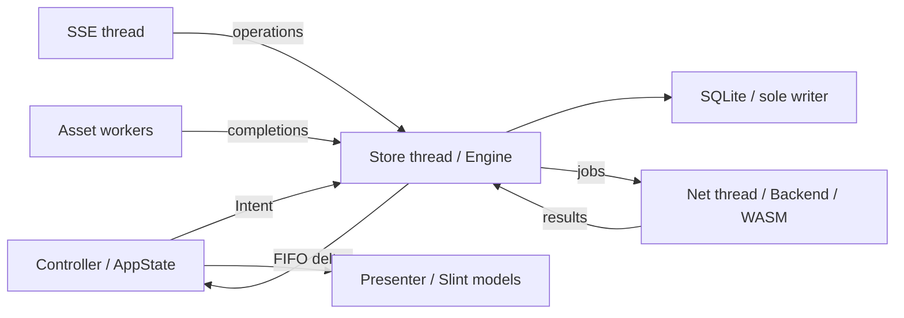

# Core model: store, worker, projection

Status: implemented through core model phase 3 and R2 typed ownership, 2026-10-18. SQLite stores
account data; FakeBackend drives offline demos and snapshots through the same
engine, controller and presenter as the account backend. Behavior is defined
in [ux-model.md](ux-model.md); engineering constraints are in
[app-design.md](app-design.md).

## Ownership



- **Store** is the only source of truth for messages, chats, contacts,
  members, drafts, the outbox, unread state, preferences and the sync
  revision. Only the worker thread opens it for writing.
- **Engine** (worker thread) turns every input into store transactions:
  server pages, older/newer pages, live operations, send results, echoes,
  unsends, reactions, receipts. After each transaction it emits deltas for what
  the UI currently watches.
- **Controller** (UI thread) holds `AppState`: plain Rust data, a *projection*
  of the store (the chat list, plus a window of the open chat), and pure UI
  state (selection, panels, focus intents, composer text). It changes the
  projection only by applying deltas. It never assigns message lists from
  responses.
- **Presenter** is the only code that touches Slint. It diffs `AppState`
  into keyed `VecModel`s (chats, messages, friends, members) and sets
  properties.

## Store

SQLite through `rusqlite` with the `bundled` feature (no system library, one C
compile). One database per account at
`$XDG_DATA_HOME/line-desktop/accounts/<own-mid-hash>/store.sqlite3`, in a
directory with mode 0700, WAL mode, `synchronous=NORMAL`. It is not encrypted
(user decision 2026-10-18). The database is a cache of server data plus drafts; a different `user_version` deletes and recreates it from `schema.sql`.

The UI never queries the database or waits on it. Drawing depends only on
`AppState`.

Tables (columns abbreviated):

- `account(own_mid, profile_json, sync_revision)`. One row.
- `chat(chat_id PK, is_group, title, avatar, member_count, muted, left,
  last_message_id, last_activity, server_unread, last_read_server_id,
  unread_stale, read_acked_server_id, receipt_server_id, removed, list_rank)`.
- `message(key INTEGER PK, chat_id, server_id UNIQUE NULL, local_id UNIQUE
  NULL, request_seq NULL, sort_ts, sort_id, sender_id, outgoing,
  body_json, reactions_json, reactions_rev, delivery,
  created_at_local, body_rev, mentioned, skip_badge)`, with an index
  `(chat_id, sort_ts, sort_id)`.
- `segment(chat_id, lo_ts, lo_id, hi_ts, hi_id, reaches_start)`. These are the
  contiguous ranges known to have no gaps (see "Gaps").
- `withdrawal(server_id PK)` remembers unsends received before a message.
- `contact(mid PK, name, status, is_group, avatar, member_count,
  original_name, overridden_name, relation, account_type, favorite_time)`.
- `member(chat_id, mid, is_self, invited)` references the contact identity;
  member reads use the current contact, so renames also change member names.
- `draft(chat_id, text, cursor, updated, anchor)`,
  `preferences(singleton, value)` (one serialized `Prefs`),
  `sticker_packages(id, value)`, `chat_detail(chat_id, wire_json)`.

`ChatInput.is_group` is a boolean and `avatar` is an optional `Asset`, decoded
when reading SQLite. `Profile` is a typed account identity (MID, display name,
status, picture path). `Friend` and `Member` belong to the store; the client
returns these types and retains no contact or member cache. `Prefs` contains
text size (15 by default), enter-sends (false), typed desktop notification and
background settings, last chat and the persisted request sequence. Preferences
cross the engine/controller boundary as a whole struct, never string-keyed values.

`left` disables sending after leaving a group; `removed` hides chats missing from a complete list sweep.
Unread uses one pure `unread(&UnreadRow) -> u32` function over the raw server
count, acknowledged/local read IDs, newest message ID and covered incoming row
count. The list query loads these inputs together. `ChatInput.unread_count` is
computed; `ChatInput.server_unread` holds the raw count. Reading through the newest
message immediately clears the raw count, so a new message before the read ack
shows one unread. `unread_stale` independently records metadata freshness.

### Content

`MessageInput.body` and `StoredMessage.body` are the same store-owned `Content`
enum. SQLite serializes this enum once into `body_json`, and deserializes it
on reads. Pending text uses `Text` as well. The variants are:

- `Text { text, spans, reply }` with typed UTF-16/UTF-8 inline emoji spans and
  an optional server message reference.
- `Photo { asset, size, album_count, caption }`;
  `Sticker { pkg, id, ver, asset, text }` (text is the server fallback).
- `File { name, size, asset }`;
  `Video { duration, asset, preview, album_count, caption }`;
  `Voice { duration, asset }`. Durations are milliseconds.
- `Contact { mid, name }`; `Location { title, lat, lon }`;
  `System { kind, params, text }` preserves server localization and literal text.
- `Withdrawn`, `Undecryptable`, `Unknown { content_type }`.

No rendered message, sender display name, outgoing flag, timestamp or reactions
are duplicated inside content. Withdrawal lives only in `Content::Withdrawn`;
its tombstone makes it sticky. `Reaction { actor, kind }` is the sole stored and
transport-decoded reaction representation; kind is a predefined ID or a paid
reaction asset. Grouping and reaction labels belong to the presenter.

The presenter maps content to today's text and media labels, including decrypt
failures and unsupported messages. It resolves sender names/avatars from the
current contact/member projection, and includes that identity in its row-cache
inputs. Asset discovery, photo viewing and reply lookup use typed fields without
re-parsing JSON. The store alone computes `unread_anchor`; the controller retains
the supplied divider for the reading session and never guesses from its window.

As a pre-release rule, a schema change discards the local store, including drafts, unsent messages, preferences and pending read acks.

`key` is the row identity for the life of the row. It does not change when a
pending send gets its server id. The UI keys every row by `key` and never by
server or local id.

### Order

There is one total order everywhere: `(sort_ts, sort_id)`.

- Confirmed rows: `sort_ts = createdTime` (falling back to `deliveredTime`),
  and `sort_id` is the server id as a zero-padded fixed-width decimal.
- Pending rows: `sort_ts = local send time`, and `sort_id = "~" + local_id`,
  so a pending row sorts after any confirmed row with the same millisecond.
- On confirmation, `sort_ts`/`sort_id` take the server values. The row keeps
  its `key` and may move by the clock difference.

### Merge rules (one function per input, all inside one transaction)

| Input | Rule |
| --- | --- |
| Server page (recent, older, newer) | Upsert by `server_id`. Content fields take the newer `rev`/edit; withdrawal is sticky; `delivery` only advances (Sent → Read). Never deletes rows. Extends or merges `segment`s. |
| Live message op (25/26/43) | Upsert by `server_id`. Outgoing op 25 with a `request_seq` matching a pending row links to that row (sets `server_id`, `delivery=Sent`). Adjacent to the newest segment when the stream is continuous since the last applied revision; otherwise starts a new segment. |
| Send result | Link the pending row by `request_seq` → `server_id`. If the echo already created a separate row, merge the two (keep the pending row's `key`, delete the duplicate, emit `Removed{key}`). |
| Send failure | `delivery = Rejected{reason}` (Not sent). Retry keeps the row; a late echo or success turns it Sent. |
| Unsend op 64/65 | body becomes `Content::Withdrawn`, `delivery` untouched. |
| Reaction op 139/140 | Replace `reactions_json` if the op's revision is newer. |
| Receipt op 55 / read ranges | Advance `delivery` to Read for outgoing rows up to the marker. |
| Read elsewhere op 40 | Advance `chat.last_read_server_id`; recompute unread. |
| Chat list page | Upsert `chat` rows. Preview and activity come from the chat's newest message row, never from the list payload, unless the list's last message is newer than anything stored. The list input carries only the last server id/time, so persist that hint and report `needs_refresh` until a page/live row catches up (M14); do not fabricate a message body. Chats absent from a *complete* list sweep are marked `removed`. |

Preview, activity, unread and history are all read from the same rows, so
they cannot disagree.

`ServerId` has a private field; every construction uses `ServerId::new`, which
rejects empty IDs and anything other than 1–20 ASCII decimal digits with no
leading zeros except `0`. A rejected wire ID is a decode failure for that item.
Zero padding preserves the `(length, lexicographic)` comparison.
`MessageInput.created_ms <= 0` falls back to a positive `delivered_ms`, then zero.

`MessageInput.rev` versions page/live content as well as reactions until a distinct
edit revision exists in the transport. A nullable `message.body_rev` records the reaction revision accompanying body data and tracks
body-field updates separately, so reaction-only operations cannot suppress a
later content update. Incoming rows enter as Sent; persisted receipt markers
upgrade outgoing rows to Read, including rows loaded after the receipt.

Page `Older.before` cursors certify adjacency to the fetched range.
Segments merge at shared endpoints or overlapping ranges; consecutive numeric
server ids alone do not certify continuity. Empty pages with `reaches_start`
mark the anchored segment (or the newest segment for Recent). An entirely empty
chat uses a minimum-cursor segment to remember that the start is known. Windows
include the anchor, up to `before` earlier rows and `after` later rows. Local
outbox rows do not certify server continuity or hide gaps between confirmed rows.
`reaches_end` means the newest stored row is included and no newer server-list
hint or uncovered confirmed row requires refresh.

### Gaps

A chat's stored rows are a union of contiguous segments. On open:

1. The engine sends the window around the anchor from the store at once,
   offline or not.
2. If the newest stored row is older than `chat.last_message_id`, or the newest
   segment is not continuous with live sync, the engine fetches recent
   messages. It merges them, and joins segments when the page overlaps one.
   If the page does not overlap, a gap remains: the window contains a "gap"
   marker row that the UI turns into an automatic newer/older fetch when it
   becomes visible.

Messages are never deleted for size. Media stays a bounded LRU cache with no
age expiry (D8).

### Outbox

Pending sends are `message` rows whose `delivery` is one of `Pending`,
`Rejected{reason}`, `Sent`, `Read` (a Rust enum serialised as
JSON, never compared as a string). The submit flow is:

1. Insert a pending row (a durable commit on the worker thread; the UI waits
   only for the `Inserted` delta, not for the disk).
2. Send it.
3. Link it, or mark it failed.

Request sequences start at a random 31-bit value per process and increment modulo 2^31; they are not preferences. Echo linking uses the sequence retained on each pending row.

The actions on failed rows are Retry (same row, new `request_seq`), Discard
(deletes the row) and Copy to composer. There is no
count cap; a chat's failed rows are listed in its row badge until resolved.

### Existing files

There is no legacy file reader or import; schema version mismatches recreate the store.
The session file remains sealed; LINE media decryption remains part of the
protocol. Media is a 128 MiB / 4096-file LRU ordered by mtime, refreshed on disk
hits, without age expiry; decoded images have a 24 MiB budget.

## Worker

### Scheduler

The worker uses two threads. The store thread owns SQLite and serves cached
subscriptions and user intents without waiting for RPCs. It alone schedules
network jobs and applies their completion events, preserving the existing merge
rules. The net thread owns the Backend (including initialization, profile,
sign-in/QR wait, sends, unsend, pages, contacts, receipts and authorization) and
only executes jobs handed to it. `online()` schedules a job; it never blocks the
store loop. Sends remain FIFO per chat while the store continues serving intents.

The store thread has one `Inbox` (a `Mutex` plus `Condvar`) with three lanes,
served in this order:

1. **User intents**: open chat, send, older/newer, mark read, retry, discard,
   friends, members, sign-in. FIFO and unbounded, because the UI produces them
   at human rate. They are never dropped.
2. **Live operations** from the SSE thread: FIFO, bounded at 256. The SSE
   thread blocks when the lane is full (backpressure, no drops).
3. **Refresh intents**: a *set* (`ChatList`, `ChatDetails(chat)`,
   `Recent(chat)`, `Receipts(chat)`, `Friends`, `Members(chat)`). Inserting an
   intent that is already present is a no-op, so duplicate refreshes are coalesced.
   Each intent records its reason only for logging.

Refresh intents are internal and have no UI. Freshness is the app's job: it
refreshes on open and when the store knows it is behind. Reconnects with an
unchanged revision restore live continuity without refreshing chats; a revision
gap or named full sync requests resync.

Resync skips chats whose resync-owned Recent request failed with HTTP 400 or
Talk ILLEGAL_ARGUMENT. Chat activity or a user request clears that chat's
suppression.

No surface gets a Refresh or Reload control. The only user-initiated retries are on things the user did: a failed
send (Retry, Discard) and an explicitly opened original or file that failed to
download.

Job completions return to the store thread after queued user intents and live
operations. Refresh work is dispatched when the net thread is available, so the
refresh set retains coalescing and priority while an RPC is running. Asset queue
handles are independent of the Backend: cached and fetched asset completions go
straight from fetchers to the UI delta channel; authorization remains a net job.

Older-history window shifts read stored rows first. A page request becomes a
background refresh and is skipped when a stored segment covers the cursor.
MoreChats raises the local limit and publishes immediately; desktop search
filters the published chat list. Mutations publish only changed chat
rows (`Changes.chats_changed`), and a draft never republishes a message window.

A live operation applies its delta directly (move the chat up, write the row,
bump unread). It only schedules `ChatDetails(chat)` when the chat is unknown
or its metadata op changed. The chat-list pagination cursor belongs to the
engine list loader. Each backend list request receives that cursor explicitly;
refreshes and live operations cannot reset an in-progress sweep. Mark-read,
send, unsend and profile writes all obtain sequences from the engine's persisted
counter. Echoes use the operation's request sequence to match the stored outbox;
the client retains no request echo map.

### Connection state machine

```rust
enum Connection {
    Fatal,                         // worker failed; restart required
    Local,                         // store open, no network attempt yet
    Connecting { attempt: u32 },
    Online,
    Offline,
    SignedOut { reason: SignOutReason },
    SigningIn,
}
```

The worker owns it and publishes each transition as one delta. The UI derives
the banner and the enabled actions from it with a pure function.

Startup is two-phase:

- **Local open** opens the store using the non-secret `last-mid` file beside the
  account store directories. It publishes the chat list, account name and last
  chat window before backend initialization (keyring/sealed session, WASM load
  and SHA-256, ImageCache prune). Unread counts are marked stale
  (ux-model §150–155). A validated profile atomically updates `last-mid`.
- **Online open** validates the profile, then resumes sync from the stored
  revision. A MID mismatch moves to `SignedOut` and leaves the store
  untouched.

Reads and in-session sends remain schedulable while Offline, with independent
per-refresh backoff. SignedOut cancels queued work; old message rows require Retry
after sign-in.

### Typed errors

`client::error::classify` is the sole network-policy boundary. It returns
`Failure::{NotDelivered, Unanswered, SignedOut, Refused, Bug}`. Transport evidence
distinguishes failure before any request byte was written from failure after
writing started. HTTP status, gateway and TalkException codes keep their
separate namespaces.
The engine reschedules reads after transport loss, retryable server failures and
gateway UNKNOWN_ERROR. Sends retry before delivery (NotDelivered, TalkException
115 or gateway UNKNOWN_ERROR) in the same session. Unanswered sends require Retry/Delete;
other Refused and Bug terminate the item. One health object publishes Offline
15 seconds after a transport failure. Successful network jobs and received
refusals, including HTTP 5xx, clear it. Cached asset hits and local-only jobs do
not affect health. SignedOut cancels queued work, preserves in-flight completions
for their account, and requires explicit sign-in. Store errors remain separate transaction
errors. Every Bug is logged at the engine error boundary with the operation,
programmer-owned Bug labels; untrusted context strings are redacted. Account-scoped dispatch requires
both a ready session and a known account MID; pending local sends wait for profile validation.
Authenticated API calls without an access token return SignedOut(NoSession).

Each refresh intent (including stream startup/restart) has its own exponential backoff: 2 seconds, 4, 8, 16,
32, then a 60-second cap, reset after success. Profile reconnection uses the
same per-refresh policy without changing visible connection state during transient failures. `Timing` is
passed at worker startup; tests inject delays, scheduler waits and the health clock.
Transport configuration separately supplies connect, socket polling, pool-idle
and asset budgets; each RPC and stream supplies a duration for its request or
ping budget. Tests select short budgets explicitly.

An unexpected worker return or panic sends one `Delta::Fatal`. The controller
enters `Connection::Fatal`, disables sends and shows “Something went wrong —
restart”. Normal shutdown sends no fatal delta.

### Sync supervisor

The SSE thread has only an HTTP transport: it reads the RPC client's shared
access-token view and requests token refresh through the worker. The RPC client
alone loads credentials, owns WASM, refreshes/persists tokens and updates that
view; token values do not travel back through stream events. Standalone sync
diagnostics construct their own owner outside the desktop engine.

The SSE thread reconnects after failures with backoff on its own thread; only
SignedOut or shutdown stops it. Read and ping failures are Unanswered. A clean
close waits 3 seconds before reopening, without changing health or failure
backoff. Repeated closes without any delivered event double this delay up to
30 seconds; a stream delivering events resets it to 3 seconds. Only the server
`reconnect` event reopens immediately. Reconnecting/Connected state transitions
follow the wait. A malformed frame is skipped. The engine supervises unexpected
stream exits and restarts them with backoff unless signed out. Live frames enter
decoding in FIFO arrival order, before refresh work. The engine persists the revision in the same transaction that applies an operation, and
seeds `localRev` from it on start (D5). Operations replayed during catch-up
carry `replay=true`, which suppresses notifications and unread increments. The
UI-thread pumps (tray, notifications, activation) become channels drained on
the event loop. They never exit on a slow turn.

### Backend seam

The engine talks to a `Backend` trait at the RPC level: `profile`, `chats`,
`messages page`, `send`, `ops stream`, and asset request handles. It has two implementations:

- `LineBackend`: the existing transport, WASM and crypto.
- `FakeBackend`: in-process, scripted. It serves canned chats and messages and
  can inject operations, delays and failures. It is compiled only for unit tests or
  with the `line/demo` feature; integration tests enable that feature via a self dev-dependency.
  Fixture data and upload pacing use `configure`; RPC failures and observations use
  `fail_rpc` and `calls()`.

The demo (`--demo`), `--snapshot` scenes and integration tests run the same
engine, store and controller on `FakeBackend`. The desktop `demo` feature enables
these modules and CLI flags; `ui-debug` implies `demo`.

## Projection and deltas

The UI subscribes to `ChatList` (sorted rows, bounded to what the list shows
plus a margin) and `Window { chat, anchor, before, after }`. The worker
answers with a snapshot, then pushes deltas in commit order over a single FIFO
(`upgrade_in_event_loop` preserves order):

```rust
enum Delta {
    Fatal,
    Connection(Connection),
    Chats { upsert: Vec<ChatItem>, remove: Vec<ChatId> },
    Window { sub: SubId, upsert: Vec<MessageItem>, remove: Vec<Key>,
             gap_markers: Vec<Gap>, reaches_start: bool },
    Unread { chat: ChatId, count: u32, stale: bool, divider: Option<Key> },
    …
}
```

- A `sub` id fences deltas for a window that was replaced by a newer
  subscription.
- The controller applies deltas immediately, including while the pointer is
  down. The presenter preserves row identity by `key`, so selection and menus
  survive patches. If pointer-down stability needs
  more than keyed patching, the presenter (not the data layer) may hold back
  *model commits* until release, without dropping anything.
- Scrolling far moves the window: the controller asks for a new window
  anchored at the visible row. The store is the history, so there is no UI-side
  retention policy.
- Image bitmaps are not stored in rows. The presenter looks them up by asset
  key in the existing decoded-image cache when it builds a row.

## Tests that must exist

Each of the following runs against `FakeBackend` through the real engine,
store and controller:

- M13: send, switch chat, return, with a stale page arriving late; the row is
  kept with the same `key`.
- M14: an incoming message in a closed chat, then opening that chat with a
  stale stored page; the row is shown and a refresh is scheduled.
- Echo before send result, and send result before echo: one row in both cases.
- Offline start shows cached chats and the cached window; reconnect resumes
  from the stored revision with no duplicate notifications.
- Chat-list pagination survives live operations.
- Updates during pointer-down are all applied, none lost.
- Unsend, reaction and receipt each update the row in place.
- Failed send: discard, retry and late echo confirmation.
- Restart: history, drafts, failed outbox items and the scroll anchor are
  restored from the store.

Out of scope: U-group surfaces, P-group protocol additions, T5 and T9.

## Implementation notes

The implementation has these specific constraints:

- The UI drains the engine's single FIFO on a 16 ms event-loop timer. Each
  delta is applied as it is drained, including during pointer interaction;
  there is no deferred-update queue.
- The existing transport has an older-page RPC but no implemented newer-page
  RPC. LineBackend answers a newer request with a recent page labelled
  `Recent`, so the store never treats an unanchored response as proof of
  continuity. Visible interior gaps fetch older messages before their upper
  confirmed boundary.
- Existing session credentials do not contain an account MID. Their first
  local open uses an empty memory store until profile validation selects the
  account's MID-hashed database. Successful validation records profile identity
  in the session so subsequent launches can open that database before network
  access. Legacy message/state files are neither read nor imported.
- RPC errors retain separate HTTP, gateway and TalkException namespaces through
  classification. Media failures retain the asset fetcher's typed failure enum.
