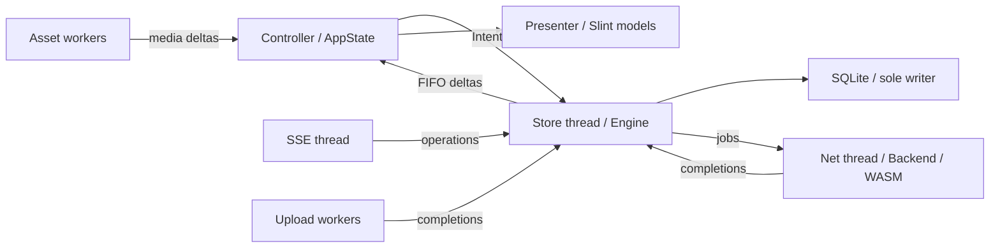

# Core model: store, worker, projection

How 閃's core is put together: crates, threads, the SQLite store, the engine
and the UI projection. `LineBackend` and `FakeBackend` run through the same
engine, controller and presenter. Behaviour is defined in
[ux-model.md](ux-model.md); engineering constraints are in
[app-design.md](app-design.md).

## Crates and threads

- `sen` (root crate, `src/`): `runtime.rs` hosts LINE's crypto WASM;
  `crypto_module.rs` finds and validates the installed module; `client/`
  implements pairing, signing, RPC, the SSE stream and media; `backend/`
  provides `LineBackend` and the feature-gated `FakeBackend`; `store.rs`,
  `engine.rs` and `controller.rs` are described below.
- `sen-desktop` (`app/`, binary `sen`): startup, Slint callbacks, the presenter
  (`app/src/presenter/`) and desktop integration (notifications, tray, portals,
  autostart).
- `sen-ui` (`ui/`): compiles the Slint sources in `app/ui/`, so Rust-only app
  edits reuse the generated UI.

| Thread | Owns |
| --- | --- |
| store thread | `Engine` and the only writable SQLite connection |
| `sen-net` | backend, credentials, the WASM runtime and RPC execution |
| `sen-sync` | the SSE operation stream |
| `sen-asset-0..2` | media downloads, decryption, decoding and the thumbnail cache |
| `sen-upload-0..1` | attachment uploads |
| `sen-http` | the process-wide async executor that drives every HTTP connection |
| `sen-emoji-font` | the once-per-start emoji font check and download |
| UI thread | Slint, `AppState`, the presenter and text editing |

Desktop D-Bus work (single instance, notifications, tray) runs on its own
threads, never on the UI thread. Transport is hyper HTTP/1 over rustls (ring,
WebPKI roots); RPC, SSE and media use separate clients and pools, and DNS uses
async-net's system lookup. Limits and deadlines are in
[app-design.md](app-design.md#transport).

## Ownership



- `Store` owns messages, chats, contacts, members, drafts, unread state,
  preferences and the sync revision. The store thread owns its writable SQLite
  connection. Pending and rejected messages in the message table form the outbox.
- `Engine` schedules network work, applies results and operations to the store,
  and publishes the subscribed chat list and message window.
- `AppState` holds the UI projection and UI state: selection, panels, composer,
  refresh failures and upload progress. It applies deltas immediately and does
  not query SQLite.
- `Presenter` updates keyed application-data models. Slint `MapModel`s project
  their rows into view data. Chats, messages, friends and members use these
  models; static lists can use `VecModel`.

## Store

`Store::open` uses bundled SQLite, WAL mode, `synchronous=NORMAL` and foreign
keys. The desktop account database is
`$XDG_DATA_HOME/sen/<mid>/store.sqlite3`.
Directory creation requests mode 0700. The database is not encrypted.
`SCHEMA_VERSION` is 14. On open, the ordered `MIGRATIONS` list in
`src/store.rs` applies steps keyed by their from-version. All applicable steps
and SQLite `user_version` updates commit in one transaction; an error rolls
them back. The 13 → 14 step drops the obsolete unread uncertainty column,
keeping local history, drafts, pending sends and preferences. Future store
changes add a step and bump the version; the local store must survive.
Newer-than-known versions are refused before any schema or journal changes.
Versions older than 13 predate migrations: the database, WAL and shared-memory
files are removed and the current schema is created.
Fresh stores are created directly at 14. The saved session is stored separately.

The tables in `src/store/schema.sql` are:

| Table | Stored data |
| --- | --- |
| `account` | Account MID, typed profile JSON, sync revision; one row. |
| `chat` | Identity, title/avatar/group metadata, mute/left/removed flags, last-message hints, unread count and read/receipt markers. |
| `message` | Stable key, chat/server/local IDs, request sequence, sort cursor, sender, content/reply/reaction JSON, body and reaction revisions, delivery, local creation time and mention/badge flags. |
| `segment` | Inclusive cursor ranges and whether a range reaches the start of history. |
| `withdrawal` | Server IDs of unsent messages, including ones not fetched yet. |
| `contact` | Identity, names, status and status metadata, avatar, group/member metadata, relation, account type and favorite time. |
| `member` | Chat/contact association with self and invited flags. Reads join the current contact identity. |
| `draft` | Chat, text, cursor, selection anchor, update time and reply reference. |
| `preferences` | One serialized `Prefs` value. |
| `sticker_packages` | Serialized sticker package list. |
| `chat_detail` | Full chat wire JSON. |

Mutators return `Result<()>`, or the created key for `insert_pending`.
`Store::mutate` accumulates committed changes internally; the engine consumes
`take_changes()`. `Changes` tracks changed chats, changed drafts, removed chats
and removed message keys. An operation's changes and sync revision commit
inside the same savepoint.

`Profile`, `Friend`, `Member`, `ChatInput`, `MessageInput` and `Content` belong to
the store model. The client decodes directly into these types. `Store::contact`
looks up one identity; `contact_ids` supplies the known-ID set used when resolving
senders. `Prefs` contains text size (15 by default), enter-sends (false), desktop
settings and last chat. Request sequences belong to the engine, not preferences.

### Content and identity

`MessageInput.body` and `StoredMessage.body` use the same `Content` enum,
serialized into `body_json`. Its variants are:

- `Text { text, spans }`, with inline emoji offsets in both UTF-16 and UTF-8;
- `Flex { alt_text, lines, links }`, the readable text and links extracted from
  a Flex message;
- `Photo { asset, size, album_count, caption }`;
- `Sticker { pkg, id, ver, asset, text }`;
- `File { name, size, asset }`;
- `Video { duration, asset, preview, album_count, caption }` and
  `Voice { duration, asset }`, with durations in milliseconds;
- `Contact { mid, name }`, `Location { title, lat, lon }` and
  `System { kind, params, text }`;
- `Withdrawn`, `Undecryptable` and `Unknown { content_type }`.

Replies are separate fields on messages and drafts. `ReplyReference` carries a
validated `ServerId` and optional service code. Rich parsing drops a malformed
reply reference while retaining the message. `Content::local_attachment` finds
prepared local files through photo or attachment assets.

`ServerId` accepts 1–20 ASCII decimal digits, with no leading zero except `0`.
Its field is private and deserialization validates it. Invalid wire message IDs
are logged and skipped by the client. `Reaction` stores an actor and either a
predefined reaction ID or an optional paid-reaction asset.

`Key` is the local row identity. Linking a pending send to a server message
keeps the pending row's key. Confirmed rows sort by server creation time
(falling back to positive delivery time, then zero) and the server ID padded to
20 decimal digits. Pending rows sort by local time and `~<local-id>`.
Confirmation updates the sort cursor and can move the row.

### Merging and continuity

Pages upsert by server ID. A newer body revision updates content, sender,
reply and badge flags; reactions have their own revision. Withdrawal tombstones
keep content withdrawn across later pages. Incoming messages enter as Sent;
persisted receipt markers can advance outgoing rows to Read.

Send results and outgoing live echoes match pending rows by request sequence.
If an echo already created a separate row, merging keeps the pending key and
removes the duplicate. Failures store `Delivery::Rejected { reason: Refusal }`;
retry keeps the row, and a late success can still confirm it. On restart, pending sends
become rejected rather than being sent automatically.

History coverage uses stored segments. Overlapping ranges merge; adjacent
numeric message IDs alone do not establish continuity. `PageKind` is `Recent`,
`Older { before }` or `Around { id }`. Older-page cursors provide adjacency to
the requested range. Local pending rows do not establish server continuity.
`Store::window` returns ascending rows, explicit gaps and start/end coverage.

Opening a window publishes cached rows first. Recent, older and around requests
run as background refreshes. Interior gaps fetch older messages before their
upper boundary. Chat-list metadata supplies last-message hints without inventing
message content; the preview comes from the newest stored message.
`ChatListItem.unread_count` is computed by the store's unread query from
`ChatInput.server_unread` and read markers. Each chat has one unread count,
shown as a number in every connection state. Incoming unread messages for an
unknown chat increment its count; later chat-list metadata replaces that count
with the server's value.

## Worker

The store thread serves local work without waiting for RPCs. Asset request
handles queue work independently of the engine, and asset completions use the
delta channel directly. Media authorisation is scheduled through the net
thread.

The `Inbox` uses a mutex and condition variable. The store loop checks health
expiry, then serves user intents, live events, job completions and eligible
refreshes in that order. User intents and completions are FIFO queues; the live
queue is bounded at 256 and applies backpressure. Refreshes form a coalescing
`BTreeSet<Refresh>`, dispatched by priority when no net job is pending. Each
refresh has its own retry deadline and attempt count. The default retry delay
doubles from two seconds to a sixty-second cap.

`publish` consumes the accumulated store changes. It upserts changed chat rows
and sends the current list order. Draft changes update the chat-list projection
without republishing an otherwise unchanged message window. A window delta
contains the current window rows, removed keys, gaps, coverage, reply targets
and unread anchor. Contacts arrive as one `Delta::Contacts` snapshot; individual
contact updates use `Delta::Contact`. Profile action results carry the action
and an `error: bool`.

### Account and connection

```rust
enum Connection {
    Fatal,
    Local,
    Connecting,
    Online,
    Offline,
    SignedOut { reason: SignOutReason },
    SigningIn,
}
```

`Connection` is presentation/transport status. The engine separately tracks
account facts in `AccountSession`: opening, absent, logging out, unusable,
ready, or signing in with a saved previous state. Probe results apply only to
their opening epoch. Cancelling sign-in restores the previous state.
Account-scoped intents use `account_allows`;
local sends can queue while waiting for profile validation.

Startup opens the local store before backend initialisation. In account mode,
an explicit MID or the non-secret `auth/last-account` selects the database;
without either, startup uses an in-memory store. The engine publishes cached
profile, contacts, preferences, chats and last-chat window before probing the
session.

`Client::from_api` requires an access token and a nonempty saved `profile.mid`.
`online_profile` rejects a different MID. Successful profile validation selects
the account store named by its validated plain MID, saves the profile and atomically replaces
`auth/last-account`. First-account work from the in-memory store is persisted when that
account has no existing database.

Native sign-in exposes four progress stages: Preparing, WaitingForPhone, SigningIn
and Authenticated. QR, scanned and PIN events carry the phone interaction.
Authenticated follows profile loading and key validation. The serialised saved
`Session` format is independent of the store schema.

Logout (`src/logout.rs`) first writes a durable `auth/logout-pending` marker
holding only identifiers and removes the saved session and
`auth/last-account`; the engine then calls `AuthService/logoutV2`, whose errors
do not stop the local logout. Finishing deletes the keyring key and, when
asked, the account's store, cache and local previews. An unfinished logout is
resumed from the marker at the next start.

### Errors and sync

`client::error::classify` maps network errors to `Failure::{NotDelivered,
Unanswered, SignedOut, Refused, Bug}`. HTTP, gateway and TalkException codes
retain separate namespaces. Transport failures distinguish requests that were
not delivered from requests that may have been delivered. Media failures map
into the same policy through `From<assets::Failure>`.

Retryable reads are rescheduled. Unanswered sends require an explicit retry;
late confirmations still reconcile with the stored row. Transport failures
start the health clock; the default offline threshold is fifteen seconds.
Successful network work and refusals clear it. Refresh failures are projected
with `RefreshFailed` and cleared with `RefreshRecovered`. Store failures use
`StorageFailed` or `InternalError`. `StorageFailed` sets the storage error line;
`InternalError` is ignored by `AppState` and only shown by desktop debug
instrumentation under `ui-debug`. Unexpected worker failure emits `Fatal`; normal
shutdown does not.

The SSE thread reads the RPC client's shared access-token view and requests
refresh through the worker. The RPC client owns token refresh and persistence.
Operations enter the engine in stream order; their revision is persisted with
the applied operation. Catch-up operations carry a typed replay flag that
suppresses duplicate notifications and unread increments. Reconnect resumes
from the stored revision.

## Projection and presentation

The public subscription messages are `Intent::ChatList { sub, limit }` and
`Intent::Window(WindowSub { sub, chat, anchor, before, after })`. Relevant delta
fields are:

```rust
Chats {
    sub: u64,
    upsert: Vec<ChatListItem>,
    remove: Vec<ChatId>,
    order: Vec<ChatId>,
}
Window {
    sub: u64,
    upsert: Vec<StoredMessage>,
    remove: Vec<Key>,
    gaps: Vec<Gap>,
    reaches_start: bool,
    reaches_end: bool,
    replies: Vec<StoredMessage>,
    unread_anchor: Option<Key>,
}
```

Subscription IDs fence responses for replaced subscriptions. `AppState` stores
window messages by key with indexes for sort order and server-ID reply lookup;
reply targets outside the window are held separately. It retains the supplied
unread divider for the reading session. The presenter resolves current sender
and reactor identities from the contact projection and maps keyed rows to
Slint models. Decoded images live in its image cache, separate from stored rows.

`Worker::on_deltas` wakes `app::event_loop`, which coalesces arrivals into a
pending `slint::invoke_from_event_loop` callback. The callback drains the delta
FIFO and applies the batch immediately, including during pointer interaction.
There is no periodic delta-drain timer or deferred pointer-down queue.

## Crypto boundary

The app runs the unmodified `ltsm.wasm` of the installed LINE for Chrome
extension through `src/runtime.rs`; nothing is copied into the repository.
The net thread owns one runtime for signing, decryption, history and sends.
`src/client/e2ee.rs` caches public-key responses (256 entries) and the client
caches channels (64). A WASM exception poisons the runtime, which is then
replaced, resetting channel pointers. A native replacement is blocked on the
proprietary SKB token and private-key loading and opaque MID conversion, so
there is no native signing or serialised-key fallback.

Media file crypto is native (`src/client/desktop/assets.rs` and `upload.rs`):
HKDF-SHA256 derives the AES-256-CTR and HMAC-SHA256 keys, and authentication
precedes decryption. The synthetic `fixtures/media.json` comes from
`tools/generate-media-fixture.go`. `examples/crypto-harness.rs` (feature
`harness`) checks synthetic Letter Sealing and signing fixtures from
`tools/generate-fixture.go` against the installed module, with an optional
explicit WASM override. Fixtures never select the app's runtime module.

## Test backends

`FakeBackend` is available for unit tests and the `sen/demo` feature.
Integration tests enable it through a self dev-dependency. Desktop `demo`
enables demo/snapshot paths, and `ui-debug` implies `demo`. The integration
flows in `tests/core_flows.rs` exercise store, worker and controller together,
including send/echo ordering, stale pages, reconnect, account changes,
attachments, reply drafts, reactions, receipts and restart recovery.
