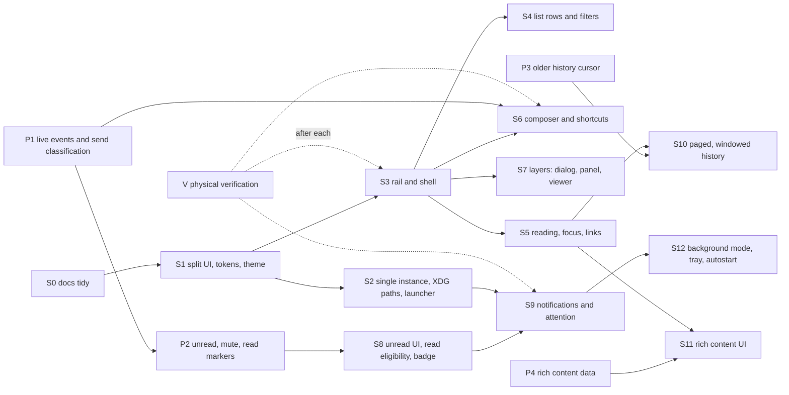

# UX implementation sessions

Written 2026-10-17 against commit `fc4c112`; implementation completed in `d1e5db5`. Each session below is sized for
one implementation session by an agent or a person, with explicit scope,
files, acceptance IDs from [ux-acceptance.md](ux-acceptance.md), and a
verification recipe. The behaviour to build is defined in
[ux-model.md](ux-model.md); do not re-derive it.

## Rules for every session

1. Read ux-model.md fully and the acceptance rows you are assigned. Do not
   read the pre-2026-10-17 history of ux-acceptance.md; it is superseded.
2. Do not touch the account unless the hand-off for your session says the
   device slot was assigned to the native app. `--demo*`, `--snapshot`,
   `cargo test`, and the MCP check are always safe. Never send a message,
   mark a chat read, change a preference on the server, or pair as part of
   verification without that authorization.
3. Keep the engineering constraints of app-design.md: Slint 1.18.1 pinned,
   software renderer, no Tokio, no JavaScript, worker owns network and
   crypto, UI thread owns models, bounded command queue.
4. Agent-started GUI/MCP previews must use `tools/run-ui-debug.py` on a private
   D-Bus session and virtual KWin output. Normal user launches stay foreground.
   Use a unique port and binary copy; retain the wrapper's reported app/scope PIDs
   and PID-file path, and stop only that owned scope. The wrapper supplies guarded
   `--debug-background` and refuses host-window fallback. Shell `&` alone is not
   a focus-safety mechanism. Headless snapshots need no compositor wrapper.
5. Required checks before hand-off:

   ```sh
   cargo fmt --all --check
   cargo test --release --offline --workspace
   cargo clippy --release --offline --workspace --all-targets -- -D warnings
   cargo build --release --offline -p line-desktop
   target/release/line-desktop --demo --snapshot /tmp/ui.ppm
   target/release/line-desktop --demo-groups --snapshot /tmp/ui-small.ppm --snapshot-size 360x520 --snapshot-text-size 24
   cargo build --release --offline -p line-desktop --features ui-debug
   cp target/release/line-desktop /tmp/line-ui-debug-9447
   python3 tools/run-ui-debug.py --binary /tmp/line-ui-debug-9447 --port 9447 --log /tmp/line-ui-9447.log -- --demo &
   # Wait for the owned preview's MCP-ready log before checking it.
   python3 tools/check-ui-mcp.py --port 9447 --scenarios --layout-photos --friends --auth-recovery --reading --layers --rich
   ```

   Convert snapshots with `magick file.ppm file.png` and look at them.
6. Update the `Impl` and `Verified` columns of your acceptance rows and add
   one verification-log row. Do not write narrative follow-up sections.
7. Scope is closed. If you find adjacent work, add it to the defect register
   at the end of this file with a proposed session, and stop.
8. Hand-off: three to ten lines in the session's "Hand-off" slot below:
   what is done, what is not, what the next session must know.

## Defect register from the 2026-10-17 audit

Each defect names the session that owns it. Structural defects come first
because every later session is cheaper after them.

| ID | Defect | Session |
| --- | --- | --- |
| D01 | `app/ui/app.slint` is one 680-line component; `app/src/main.rs` is a 2,200-line `View` with one 500-line test. Every UI change edits the same two blobs. | S1 |
| D02 | Two launches run two workers against the same session, caches, and `desktop.state` (two writers). No single-instance guard. | S2 |
| D03 | Drafts and outbox live under `artifacts/auth/desktop-state` inside the repository; the launcher hard-codes repository paths. | S2 |
| D04 | Destination buttons use *disabled* as the selected state; no rail, no icons; Settings, account name, and status text sit in the list footer. | S3 |
| D05 | A general status line carries "busy", "Loading…", and conversation counts. | S3 |
| D06 | Permanent captions: "Searches loaded conversation names only", "Searches loaded friend and group names. Select a profile, then Open chat.", "Enter inserts a line. Ctrl+Enter sends.", "Changes apply immediately and are saved on this device.", "Opens recent history or an empty conversation. No message is sent.", "Recent history · older messages are unavailable", subtitle "Recent history · read receipts unavailable". | S3 |
| D07 | Add friend is a destination whose only content is that it is unavailable. | S3 |
| D08 | Window title shows the account name. | S3 |
| D09 | Settings, profile, viewer, and sign-in each hide the entire window, including in wide layout. | S7 |
| D10 | Narrow layout: Back is a plain 84 px button in a 100 px header; no keyboard path back. | S3 |
| D11 | `withUnreadCount:true` is requested from the server and the count is discarded; no unread badge anywhere. | P2, S8 |
| D12 | No mute, draft, failed-send markers; no outgoing prefix in previews; times are `M/D` or `HH:MM` only. | S4 |
| D13 | No category filter; search matches names only. | S4 |
| D14 | List keyboard: no Up/Down outside the search field, no conversation-switch shortcut, no Ctrl+F. | S4 |
| D15 | The "Loading recent messages…" and error row is inserted above the history and shifts it. | S5 |
| D16 | Every message body is a Tab stop; focusing one turns following off; Up/Down inside a body move the caret instead of scrolling. | S5 |
| D17 | History keyboard scrolling exists only as PageUp/PageDown on a 0×0 focus scope that Tab cannot reach. | S5 |
| D18 | Links are plain text: not detected, not inspectable, not openable. | S5 |
| D19 | Content types: file, contact, system, withdrawn, unknown all render as one "Unsupported message" string; video and voice are text labels; no reply structure. | S5 (placeholders), P4 (data) |
| D20 | Date dividers are raw `YYYY/MM/DD`. | S4 |
| D21 | Accessible labels: messages are "Incoming message"/"Outgoing message" without sender or time; chat rows expose only the title. | S5 |
| D22 | Three scrollbar styles: custom `Pane`, `ListView`, `TextEdit`. | S1 |
| D23 | Anchor tracking runs a `changed screen-y` callback on every row every frame plus 1 ms and 16 ms timers; it cannot scale to paged history. | S10 |
| D24 | Emoji appear monochrome in the software renderer in snapshots; desktop rendering unverified. | V |
| D25 | History is capped at 50 recent messages; no older paging. | P3, S10 |
| D26 | Switching chats replaces the editor text, losing caret, selection, and undo. | S6 |
| D27 | No "Enter sends" preference; Shift+Enter untested; no Escape behaviour in the composer; Ctrl+Enter is the only shortcut in the app. | S6 |
| D28 | `sending` property is set but unused. | S6 |
| D29 | Every send failure is reported as Uncertain and also flips the app to "connection failed", showing the authentication banner. | P1, S6 |
| D30 | No live receive: messages arrive only on manual Refresh or after a send. | P1 |
| D31 | No read markers, no unread boundary; "read receipts unavailable" is a hard-coded subtitle. | P2, S8 |
| D32 | No notifications, badge, sound, attention hint, tray, or autostart. | S9 |
| D33 | Window focus and occlusion are not tracked except to reset the IME flag. | S8 |
| D34 | Fixed light palette on custom elements while standard widgets follow the system scheme: mixed look on a dark desktop. | S1 |
| D35 | Dozens of hard-coded 10–14 px and 22–24 px font sizes; at text size 24 the captions stay 11 px and the Back button becomes huge. | S1 |
| D36 | Friend rows are centred-text buttons with a "Group · " text prefix instead of list rows with section headers. | S4 |
| D37 | Viewer lacks wheel zoom, drag pan, keyboard zoom, Save, previous/next. | S7 |
| D38 | Desktop entry lacks `SingleMainWindow`, `StartupNotify`, `Keywords`, `DBusActivatable`; no D-Bus activation. | S2 |
| D39 | No `xdg-open` integration. | S5 |
| D40 | Escape on the sign-in sheet cancels an in-flight pairing without confirmation. | S7 |
| D41 | One worker thread serialises chat-list, history, image, and send work; a long chat-list call delays Send; the idle loop wakes every 200 ms. | P1 |
| D42 | No token refresh; the Chrome extension shares the device slot, so every live check needs the slot handed to the native app. | user decision |
| D43 | Four documents carry overlapping append-only narratives; HANDOFF.md's "current task" describes the 2026-10-15 Chrome audit. | S0 |

## Dependency graph



P sessions are protocol work in the worker and `src/client`. They can run
in parallel with S3–S7 because they only add `Update` variants and
`Command`s; the UI sessions that consume them come later.

---

## S0 — Documentation tidy (small)

**Goal.** Make the docs navigable so later sessions read less.

**Scope.** Rewrite HANDOFF.md's first section to describe the current state
(this plan, the device-slot blocker, safe commands). Move the "UX
implementation checkpoint" and later narrative sections of app-design.md
into a short "History" list with commit references. Point README.md at
ux-model.md and ux-sessions.md. Do not change any requirement.

**Out of scope.** Code.

**Done when.** A new reader can find: how to build, what is safe to run,
what the model is, what to do next, in under two minutes.

**Hand-off.** S0 completed 2026-10-17: HANDOFF starts with the current plan,
device-slot blocker, and safe offline commands; README links the normative model,
sessions, and acceptance record. app-design checkpoint narratives are condensed
into commit-referenced History. Requirements and historical protocol evidence
are retained. S1 is next; native account access remains unauthorized.

---

## S1 — Split the UI, introduce tokens, follow the system theme

**Goal.** No behaviour change. Make the UI editable and themeable.

**Acceptance.** VIS1, VIS2, SH4 (single scrollbar component). Defects D01,
D22, D34, D35.

**Scope.**

- Split `app/ui/app.slint` into `app/ui/` files: `tokens.slint` (type scale,
  spacing, colour roles), `scrollpane.slint` (`Pane`), `rail.slint`,
  `chats.slint` (list and search), `friends.slint`, `conversation.slint`
  (header, history, latest), `message.slint` (one row), `composer.slint`,
  `sheets.slint` (settings, profile, viewer, sign-in), and `app.slint`
  (window, properties, callbacks). Keep every exported property and callback
  name so `main.rs` compiles unchanged except for `include_modules!` paths.
- `tokens.slint`: a `global Tokens` with `base: length` bound to the text
  size and derived `small`, `caption`, `heading`, `title`, `time` lengths
  per model §10, spacing constants, and colour roles taken from the
  std-widgets `Palette` (background, alternate-background, foreground,
  accent, selection, border) plus `danger` and `outgoing-bubble`. Replace
  every literal `font-size: NNpx` and every literal colour with a token.
- Use `Pane` for the chat list and friend list as well, or restyle
  `ListView` to match `Pane`; pick one and delete the other look. The
  composer's `TextEdit` scrollbar may remain if it cannot be restyled;
  record it.
- Split `main.rs`: move `View` into `app/src/view.rs`, list and friends
  logic into `app/src/browser.rs`, message presentation helpers
  (`group_messages`, time formatting) into `app/src/present.rs`, and break
  the single test into one test per scenario in `app/src/tests/`.

**Verification.** All four required checks. Snapshots before and after at
980×720/15 and 360×520/24 must differ only where font sizes now scale. Run a
desktop instance with a dark Plasma colour scheme and screenshot it; custom
surfaces must follow.

**Done when.** `rg "px;" app/ui | rg "font-size"` finds no literals outside
`tokens.slint`; `rg "#[0-9a-f]{6}" app/ui` finds none outside
`tokens.slint`; tests and MCP pass; dark screenshot is consistent.

**Hand-off.** S1 implemented: Slint surfaces are separate components with shared
presentation State and Palette-based Tokens; AppWindow keeps its Rust API through
weak callback forwarding. View/browser/present and named controller scenarios are
separate modules; cumulative scenario setup remains a maintainability limitation.
Chats/friends/history use Pane. Standard TextEdit and viewer/profile/auth ScrollView
scrollbars remain exceptions for later layer work. Required offline tests, format,
Clippy, MCP batch, both snapshots, and actual BreezeDark desktop screenshot pass.
Snapshots include concurrent S3 shell changes and prepared S5 accessibility fields;
physical input/theme/scale V and all account verification remain pending.

---

## S2 — Single instance, XDG paths, desktop entry

**Goal.** Running the app twice cannot corrupt state; files live where the
desktop expects.

**Acceptance.** OS1, OS2, OS6. Defects D02, D03, D38.

**Scope.**

- Add a D-Bus service on a dedicated thread (zbus with its blocking API, or
  the `dbus` crate; no Tokio). Own `org.lineclient.Desktop`. Implement
  `org.freedesktop.Application` at `/org/lineclient/Desktop`: `Activate`
  raises the window, `Open` is accepted and ignored for now, `ActivateAction`
  accepts `open-chat` with a chat id string (used by S9). If the name is
  already owned, call `Activate` on the owner and exit 0 before creating a
  window. If D-Bus is unavailable, fall back to a lock file under
  `$XDG_RUNTIME_DIR/line-desktop.lock` and continue single-instance-less
  with a visible warning in Settings.
- Paths: default session path `$XDG_DATA_HOME/line-desktop/session.json`,
  state `$XDG_STATE_HOME/line-desktop/`, cache unchanged. Keep `--state`,
  `--wasm`, `--cache-dir`. On first run with the new defaults, if the old
  repository paths exist, do nothing automatic: show one dialog offering
  "Use existing files" (passes the old paths this run and writes a config
  file with them) or "Start fresh". Never copy credentials silently.
- `tools/install-desktop.py`: write `SingleMainWindow=true`,
  `StartupNotify=true`, `DBusActivatable=true`, `Keywords=chat;messaging;`,
  `X-KDE-Protocols` unset; drop the hard-coded `--state`/`--wasm` arguments
  unless `--dev-paths` is given. Install a `dbus-1/services` file so
  activation can start the app.

**Verification.** Launch twice; the second exits and the first is raised
(KDE will show the activation). `busctl --user introspect
org.lineclient.Desktop /org/lineclient/Desktop`. Tests for the path
resolution and the lock fallback.

**Done when.** SC15's first step passes on the desktop.

**Hand-off.** S2 implements pre-worker single-instance ownership, the standard
Application D-Bus methods, and an XDG runtime lock fallback with Settings warning.
Default session/WASM, drafts/outbox, and cache use XDG data/state/cache; choosing
legacy files explicitly records paths without copying credentials. The installer
stages a D-Bus service and supports repository paths only with `--dev-paths`.
Five synthetic activation/path/migration/lock tests, private-bus dispatch, isolated
Clippy, normal/dev installer staging, and two offline demo launches pass. Physical Wayland raising and activation
tokens remain unverified; notification use belongs to S9. No account was opened.


---

## S3 — Rail, shell, feedback placement, wording

**Goal.** The shell looks and behaves like the model §3, §9: a rail, no
status line, no captions, a window title of "LINE".

**Acceptance.** SH1, SH6, SH9, NAV10, FB1, FB3, FB4, CMP10. Defects D04–D08,
D10.

**Scope.**

- `rail.slint`: vertical rail 56 px wide with Chats and Friends icons
  (SVG assets under `app/assets/icons/`), selected indicator, badge slot
  (empty until S8), Settings and account avatar at the bottom. Remove Add
  friend entirely (model §12). Narrow layout: the rail becomes a 48 px
  bottom bar on the browser pane; the conversation pane header shows a Back
  arrow icon button; Alt+Left and the Back mouse button go back.
- Delete `status`, `account-name` footer text, and all captions listed in
  D06. Move the search scope into the search empty state ("No match among
  loaded conversations"). Move the shortcut help into Settings. The
  "older messages are unavailable" line is replaced by nothing until S10
  adds real end-of-history items; a chat with exactly 50 loaded messages
  shows a quiet "Older messages are not loaded yet" item at the top (this
  is the one place that limitation is disclosed).
- Conversation header: title, and subtitle only when there is real
  information (group member count when P4 supplies it; otherwise nothing).
- Window title: "LINE" in account mode, "LINE (preview)" in demo mode.
- Keep every existing callback. The chats-list `Refresh` button stays until
  P1 lands; move it into the header as an icon button.

**Verification.** MCP script updated to find controls by new labels;
snapshots at both sizes; keyboard: Tab from the rail reaches search in one
step.

**Done when.** `rg "Searches loaded|Enter inserts|No message is sent|read receipts unavailable|Refresh to update" app/ui app/src` is empty; title and rail visible in snapshots.

**Hand-off.** S3 completed in checkpoint `3639708`: icon rail and narrow bottom bar,
compact Back, fixed LINE title, local list feedback, removed explanatory captions,
and Settings shortcut help. Full required checks passed in the combined S1/S3
checkpoint; inspected final normal and small snapshots and full MCP log.
Unread on Back remains S8; history feedback overlay remains S5; physical input
verification remains V. S4 can use shared State and the split browser components.

---

## S4 — Conversation list rows, friends rows, filters, list keyboard

**Goal.** Rows carry the model's metadata and the list is keyboard
complete.

**Acceptance.** NAV3 (except unread badge), NAV4, NAV5, NAV13, NAV15, RD11
(dividers), IN1 (list part). Defects D12–D14, D20, D36.

**Scope.**

- `ChatRow` gains `draft: bool`, `failed: bool`, `muted: bool` (muted stays
  false until P2), `outgoing-preview: bool`. Preview text for outgoing last
  messages is prefixed with the localized "You: ". `present.rs` gets
  `relative_time(ts, now)` and `day_label(ts, now)` per model §9.2 with
  unit tests at the boundaries (midnight, week edge, year edge).
- Category chips above the list: All, Friends, Groups. Official accounts
  appear under All until the protocol distinguishes them. Chips filter
  without changing the open chat (reuse the existing filter path).
- Keyboard: the list is one Tab stop; Up/Down move a focus cursor; Enter or
  Space opens; Home/End; type-ahead is out of scope. Alt+Up/Down anywhere in
  the window switches to the previous/next row of the visible list. Ctrl+F
  focuses the browser search of the current destination. Ctrl+1/2 switch
  destinations.
- Friends: rows with avatar, name, status line; two section headers
  (Friends, Groups) that collapse; single click opens the profile (panel
  after S7; sheet until then). Remove the "Group · " prefix.

**Verification.** Unit tests for time formatting; MCP: chips filter, Alt+Up
switches, draft marker appears after typing; snapshots.

**Done when.** The acceptance rows list `S M`.

**Hand-off.** S4 implemented after `3639708`: metadata markers and outgoing prefixes,
All/Friends/Groups filters, calendar list times/dividers, collapsible friend/group
rows, one-stop list keyboard and guarded global browser shortcuts. Dedicated
browser MCP and both browser controller tests pass, including narrow visible Tab
traversal. Normal/small and dark desktop snapshots were inspected. Calendar
boundary tests pass 2/2; collective formatting, 73 desktop/32 library tests and
Clippy pass. Final combined MCP is logged in acceptance. Unread badge stays S8;
Official classification awaits protocol data. No physical/account verification.

---

## S5 — Reading: focus, keyboard scrolling, loading placement, links, placeholders, labels

**Goal.** The history is a first-class keyboard surface and never shifts
under the reader.

**Acceptance.** RD7, RD13, MSG3, MSG4, MSG5, MSG7 (placeholders), MSG9,
IN1 (history part), OS9. Defects D15–D19 (presentation), D21, D39.

**Scope.**

- Message bodies: `focus-policy: click-only` on the read-only `TextInput`
  (or an equivalent that removes them from the Tab chain). Focusing a body
  no longer sets `following = false`; only pointer drag selection and
  scrollbar interaction do.
- The history `Pane` becomes a real focus target: a visible focus ring on
  the pane edge, Up/Down scroll by one line, PageUp/PageDown by 90 %,
  Home/End to beginning/end (End sets following). Tab order per model §8.2.
- Loading and error states for the recent page move into the header strip
  area as a 24 px line that overlays the top of the history with a solid
  background; it does not participate in the history layout. Retry stays.
- Links: detect `https?://` and `www.` runs in `present.rs` (unit-tested
  with Japanese punctuation adjacency). Render as a separate `Text` run
  with underline and accent colour; a hover tooltip or the context menu
  shows the full URL; activation calls `xdg-open` from a helper thread.
  Drag across a link selects. Copy link in the menu.
- Placeholders: one `MessageRow.kind` enum (text, photo, sticker, video,
  voice, file, location, contact, system, withdrawn, undecryptable,
  unknown) with a distinct icon and short label each. The worker maps
  `contentType` to the enum (P4 adds the real data). System and withdrawn
  items are centred, bubble-less.
- Accessible labels: "Incoming from {sender}, {time}: {text}" and
  "Outgoing, {time}, {delivery}: {text}"; chat rows: "{title}, {time},
  {preview}, {n unread}" when known.

**Verification.** MCP: Tab from search reaches the composer in a bounded
number of steps (count them, assert ≤ 8); history Up/Down scroll; loading
row no longer changes the first message's y; link activation is stubbed in
demo mode to record the URL. Snapshots with every placeholder kind in
`--demo`.

**Done when.** Acceptance rows read `S M`; `check-ui-mcp.py` has a
`--reading` flag that runs the new checks.

**Hand-off.** S5 implements history focus/keys, stable recent loading/error
strip, typed placeholders and accessible labels. Four URL/kind/label tests and
`--reading` MCP pass on debug SHA `241b3ed17333` (01:12:05 UTC): four Tabs to
composer, scrolling, loading geometry, URL inspection/menu copy/stub activation,
twelve kinds and selected-body chat switch; top/bottom dark snapshots inspected.
Slint 1.18 uses explicit surface traversal and separate underlined URL action
runs below the selectable body; dragging an action run selects the whole body.
MSG5 remains partial for inline styling; MSG3 for full native-menu mutation
deferral (no toolkit open-state hook). Selection release is queued safely.
Physical pointer/IME/default-handler checks and account use remain pending.

---

## S6 — Composer, shortcuts, send states

**Goal.** Composer state survives everything; send states are complete.

**Acceptance.** CMP1, CMP2 (guard part), CMP5, CMP8 (text), OUT2, OUT5,
OUT6, OUT7, IN3, IN7. Defects D26–D29. Depends on P1 for the Rejected
classification; implement the UI first with the demo scenario producing
both outcomes.

**Scope.**

- Per-chat composer state: text, caret, selection anchor, scroll. On chat
  switch, restore via the `TextEdit` properties available in Slint 1.18
  (`cursor-position`/`anchor-position` on the inner `TextInput` through a
  thin wrapper component if `TextEdit` does not expose them). Never call
  `set_draft` while the composer has focus and the chat is unchanged.
- Preference "Enter sends" in Settings (default off). Shift+Enter always
  inserts a newline. Escape in the composer does nothing. Ctrl+Q quits.
  Settings lists all shortcuts from model §8.1.
- Outgoing marks: Sending, Sent, Read (when P2 supplies), Not sent
  (Rejected), Unconfirmed (Uncertain), each with icon plus accessible
  label. Rejected shows Retry and Edit; Uncertain shows Resend (opens a
  confirmation that names the duplicate risk) and Edit. Edit appends to a
  non-empty draft only after a confirmation that offers Replace or Append.
- `SendFailed` splits into `SendRejected { reason }` and `SendUncertain`.
  Neither changes `connected` or `connection-failed`; connection state is
  owned by P1's sync status. Remove the unused `sending` property or bind
  it to a Send-button spinner.
- Pasting multi-line text keeps line breaks (verify; Slint `TextEdit`
  should already do so).

**Verification.** Controller tests: caret restored after switching; Enter
with preference on sends only when `ime-active` is false; Rejected and
Uncertain render different marks and actions; a rejected send leaves
`connected` true. MCP: both outcomes via demo buttons.

**Done when.** Rows read `S M`; IME rows still `P—` and say so.

**Hand-off.** S6 implements native byte-offset caret/selection and scroll restoration,
unchanged-chat protection, encrypted Enter-sends preference, Shift+Enter and IME
shortcut guards, base Escape and Ctrl+Q through the normal flush/stop path.
SVG delivery slots expose Sending/Sent/Read/Not sent/Unconfirmed; rejected Retry
and uncertain duplicate-confirmed Resend are distinct. Edit confirms Replace or
Append before touching a newer draft; Resend preserves the original uncertain row.
Persisted random-seeded monotonic request sequences reconcile only protocol-validated
own echoes, including late originals after Resend. Legacy rows without a request
sequence cannot identify an unknown echo; no content-based guessing occurs.
Three focused controller tests and composer MCP pass; collective checks remain. Physical IME P—.

---

## S7 — Layers: Settings dialog, profile and members panel, viewer, sign-in

**Goal.** Surfaces use the layer rules in model §3.2.

**Acceptance.** SH8, IN3, IN4, IN5, WIN6, WIN7 (shell part), WIN1 (Save/
Cancel pattern for future account edits). Defects D09, D37, D40.

**Scope.**

- Settings: a centred dialog (max 560×640) over a dimmed main window in
  wide layout; a sheet in narrow layout. Focus trapped; Escape closes;
  opener refocused. Tabs or sections: Chats (text size, Enter sends),
  Notifications (placeholder controls disabled with a one-line reason
  until S9), Shortcuts (read-only list), About.
- Profile: a right-side panel 320 px wide in wide layout; a sheet in narrow.
  The history remains visible and interactive. Open chat closes the panel.
- Viewer: stays a sheet. Add Ctrl+wheel and plain wheel zoom around the
  pointer, drag to pan, `+`/`-`/`0`/`1` keys, Save (portal file chooser,
  or `$XDG_DOWNLOAD_DIR` with a transient confirmation if the portal is
  unavailable), previous/next within the loaded photos of the chat.
- Sign-in: Escape while busy opens a small confirm dialog (Keep waiting /
  Cancel sign-in). Escape when idle closes the sheet.
- A single `Layers` component manages the stack and focus restoration so
  future dialogs reuse it.

**Verification.** MCP: open settings, viewer, profile, menu in turn and
dismiss with Escape; assert the composer draft never changes and that
focus returns to each opener (check `has-focus` through accessible
properties). Snapshots in wide layout show the conversation behind the
dialog.

**Done when.** SC14 passes in MCP.

**Hand-off.** S7 implements one Layers stack for Settings, profile, sign-in and viewer. Expanded private virtual-KWin MCP 9452 `--layers` passes focus restoration, profile/viewer keys, wheel zoom, pan, loaded-photo navigation, isolated PNG Save and draft retention. Physical chooser/compositor input remains unverified.

---

## P1 — Protocol: live events, reconnect state, send classification

**Goal.** The worker receives messages without user action and reports the
connection state truthfully. This is protocol work; the UX sessions
consume its contract.

**Acceptance enables.** RD3 live, OUT5, OUT7, WIN4, everything in UNR and
ATT later. Defects D29, D30, D41.

**Scope.**

- Confirmed on 2026-10-17 from the extension bundle (structure only): the
  push channel is **Server-Sent Events**, `GET
  https://line-chrome-gw.line-apps.com/api/operation/receive?localRev=<rev>`
  with credentials (the `lct` cookie; add the usual signed headers and
  verify which are required). `localRev` is seeded from
  `TalkService/getLastOpRevision`. Named events: `ping` (expected every
  20 s, 10 s grace, else reconnect), `connInfoRevision`, `reconnect`,
  `talkException`, `fullSync` (`{reasons, nextRevision}` → run a full
  resync with getMessageBoxes/getChats/getRecentMessagesV2, set
  `localRev = nextRevision`, reconnect), `partialFullSync`. Unnamed
  `message` events carry one operation JSON `{revision, createdTime, type,
  reqSeq, …}`; the numeric `type` enum (receive message, send message
  from another device, read notification, chat updates, membership) still
  needs to be extracted from the bundle and recorded in chromium-ui-map.md.
  Reconnect uses exponential backoff capped at 600 s. An unauthorized SSE
  response triggers `renewToken()`, which is the token-refresh path D42
  needs. Read receipts are fetched with `TalkService/getMessageReadRange`;
  reads are sent with `sendChatChecked`. The HAR under `dumps/` does not
  contain the SSE stream, only the surrounding thrift calls.
- Worker: a second thread owns the long-poll loop and pushes operations to
  the existing worker through its command queue (or a dedicated bounded
  channel); the UI never blocks on it. Backoff on failure, cancellation on
  quit, catch-up after reconnect with deduplication by message id.
- New `Update` variants: `Sync(SyncState)` with `Connected`, `Reconnecting
  {attempt}`, `Offline`, `AuthExpired`; `Incoming { chat, messages }`;
  `ChatMeta { chat, title, preview, timestamp, unread?, muted? }` (unread
  and muted filled in P2); `Receipt { chat, up_to_message, reader_count? }`.
- Send classification: HTTP 4xx and explicit error payloads → `SendRejected
  { reason }`; timeouts and transport errors without response → 
  `SendUncertain`. Unit tests with recorded response shapes (synthetic).
- Worker loop: replace the 200 ms idle wake with blocking `recv` plus a
  wake on job arrival; prioritise Send and Messages over image jobs
  (already) and keep chat-list fetches from starving Send by splitting
  contact lookups into a follow-up command.

**Verification.** Synthetic tests with a fake transport for: ordered
delivery, duplicate suppression after reconnect, auth-expired mapping,
rejected versus uncertain. No account use unless authorized; if the slot
is assigned, one read-only live-poll run for five minutes with counts only.

**Hand-off.** SSE transport has bounded private delivery, replay suppression,
30 s ping watchdog, seed/connect backoff and explicit sync state. Joined worker
shutdown cancels, kills and reaps RPC/media/SSE children; session epochs fence old
token events. Refresh transport outages reconnect; definite auth rejection expires.
Persisted request sequences plus encrypted ciphertext-envelope bindings reconcile
lost confirmations from either operation echoes or recent-page catch-up, including
restart; no text heuristic or automatic resend is used. Synthetic transport,
cancellation, auth and send tests pass; source-only header/refresh evidence and
loaded-native-scope resync limits are in chromium-ui-map.md. No live/physical test.

---

## P2 — Protocol: unread counts, mute flags, read markers

**Goal.** Unread state has a server source and a way to clear it.

**Acceptance enables.** UNR1–UNR5, NAV3 badge, ATT withdrawal.

**Scope.**

- Surface `unreadCount` from `getMessageBoxes` (already requested) into
  `Chat`, `ChatView`, and `ChatMeta`. Trace the chat notification/mute
  setting source in Chrome and surface `muted`.
- Trace the read marker (`sendChatChecked` or its current equivalent) and
  the read-elsewhere operation; implement `Command::MarkRead { chat,
  up_to_message }` with coalescing (one request per second per chat) and
  an `Update::ReadElsewhere { chat, up_to_message }`.
- Define the watermark semantics in ux-model.md §7.1 precisely once known
  (per-message or per-chat last-read id).

**Verification.** Synthetic tests; no live marking without authorization.

**Hand-off.** Chat and worker views preserve optional unread counts, mute and
last-seen metadata. MarkRead advances a monotonic per-chat watermark with a
bounded coalescer (at most one request/second/chat); read-elsewhere and exact
per-member read-range updates have separate events. Source mute is Chrome user
storage rather than a server flag, so unknown remains unknown; no server
preference is fabricated or changed. Synthetic tests cover coalescing, stale
boundary suppression and range/sentinel parsing. UI eligibility remains S8;
no live read marker was sent.


---

## P3 — Protocol: older history cursor

**Goal.** `Command::Older { chat, before_message, delivered_time }` using
`getPreviousMessagesV2WithRequest` per chromium-ui-map.md, with inclusive
cursor duplicate removal, cache integration (pages keyed by range), and
`Update::Older { chat, messages, reached_beginning }`. Decoded memory stays
bounded (evict pages far from the viewport; S10 asks for ranges).

**Verification.** Synthetic tests with a fake transport: three pages, a
failure, retry, beginning reached, no duplicates.

**Hand-off.** Older commands use the sourced delivered-time/message-ID cursor,
remove the inclusive boundary and duplicate IDs, and return an explicit end flag.
Encrypted range pages include that flag and share the bounded 512-message/16 MiB
memo and 32 MiB/256-page disk budget. Failed requests store no page, so Retry
keeps the boundary. Synthetic transport tests cover three pages, failure/retry,
cache restore, no duplicate IDs and beginning reached. S10 owns viewport ranges
and anchor/window retention; no live older-history request was made.


---

## P4 — Protocol: rich content data

**Goal.** Supply the data S5's placeholders and S11 need: inline emoji
spans (`REPLACE.sticon` with UTF-16 offset validation per the map), reply
references, file name and size, video and voice duration, contact name,
system message text, withdrawn flag, group member counts. No UI.

**Hand-off.** P4 typed parser and membership helper implemented in
`src/client/desktop/rich.rs`; protocol integration adds the details to decoded
messages and chat metadata. Four synthetic parser tests cover mixed Japanese/astral
UTF-16 offsets, surrogate boundaries, overlapping/malformed spans, attachment
metadata, reply relation filtering, and membership counts. System localization
keys/arguments are retained when literal text is absent; withdrawal state comes
from destroy operations. S11 still owns rendering, emoji assets, and reply jumps.
No account requests were made; live protocol compatibility remains unverified.

---

## S8 — Unread UI, read eligibility, window state, app badge

**Goal.** Unread is visible, correct, and cleared only by reading.

**Acceptance.** NAV3 badge, NAV7, RD1 unread, UNR1–UNR5, OS4, WIN3 unread
part. Defects D11, D31, D33. Depends on P1, P2, S2 (D-Bus thread), S4.

**Scope.**

- Track window state: winit `Focused` and `Occluded` through the existing
  event observer into `window-active: bool`; unknown → inactive.
- Per-chat unread model in `view.rs`: server count, local boundary message
  id, divider position. On open: if unread, scroll so the divider is one
  third from the top; the divider persists until the chat is left.
- Read eligibility: a `Timer` is not used; eligibility is evaluated on
  scroll, on focus change, on layer change, and on arrival. Exposed
  messages advance the local boundary immediately (badge updates) and
  enqueue `MarkRead` coalesced. Losing activation stops marking.
- Badge on rail destination, on Back in narrow layout, on rows; app badge
  through LauncherEntry on the D-Bus thread with `count-visible` false at
  zero. Window title "LINE (3)".
- Restart shows last known counts marked stale (dot, not number) until the
  first sync.

**Verification.** Demo scenarios for arrivals in another chat and in the
open chat while scrolled up; controller tests for eligibility under each
condition in model §7.2; `busctl --user monitor` shows LauncherEntry
updates on the desktop.

**Hand-off.** Server counts, persistent stale dots, row/rail/narrow Back badges,
window title and coalesced LauncherEntry count are wired. Actual row-start
exposure, focus/occlusion, pane visibility, loading and modal state gate reads;
a shared atomic epoch revokes pending markers even with a full command queue.
Unread boundaries larger than a page are discovered through bounded older
paging; ambiguous/inconsistent boundaries stay undisclosed rather than guessed.
The divider survives reads until leaving; exact start-exclusive read ranges
supply receipts. Nine S8 tests plus the queue-saturation revocation test pass.
Private virtual-compositor MCP passed synthetic scrolled arrivals, other-chat
badges, stable anchor, Latest and persistent divider; the background launch made
no host focus request and its owned scope was closed. No live marker or physical
badge/desktop verification was performed.


---

## S9 — Desktop notifications and attention

**Goal.** The attention matrix (model §7.4) is implemented with native
notifications.

**Acceptance.** ATT1–ATT9, OS3, OS5, OS12, WIN1 notification settings.
Defect D32. Depends on S8, S2, P1.

**Scope.**

- Notification service on the D-Bus thread: `Notify` with `desktop-entry`,
  `category`, `urgency`, `replaces_id` per chat, actions `default` and
  `mark-read`; `CloseNotification` for withdrawal; handle `ActionInvoked`,
  `NotificationClosed`, and `ActivationToken`. Avatar `image-data` only at
  privacy level 1.
- Grouping: per-chat replace, two-second sound window via the
  `sound-name` hint; if Plasma ignores the hint, record it and leave sound
  for a follow-up.
- Activation: on `default`, request focus. Try the activation token path
  first (check what winit 0.30 exposes for consuming an external token; if
  nothing, call `focus_window()` and `request_user_attention`), then select
  the chat and scroll to its boundary. Record which path worked on Plasma
  Wayland in the acceptance log.
- Settings → Notifications: enable, preview level, sound, mention exception
  for muted chats, group events, and a "Send test notification" button.
  Show "Notification service not available" when `GetServerInformation`
  fails; never a permission prompt loop.
- Suppress: own messages, receipts, reactions, replayed history during
  catch-up, muted chats (except mention exception), and anything while the
  chat is exposed in an active window.

**Verification.** Demo mode gets `--demo-notify` which drives the matrix
with synthetic events against the real daemon on the developer's desktop.
Controller tests for the matrix decision function (pure function: state ×
event → actions). SC10, SC11, and the rest of SC15 on the desktop.

**Hand-off.** S9 implements quiet persisted preferences, a bounded joined D-Bus worker, per-chat replacement, two-second sound limiting, three privacy levels, activation actions/tokens and withdrawal. Pre-deferral attention and unread are processed exactly once; read exposure waits for successful worker acknowledgment. Pure matrix and isolated daemon-contract/unavailable-bus/shutdown tests pass; private virtual MCP confirms truthful unavailable-service feedback. Physical Plasma activation/token fallback, DND, lock-screen privacy and sound remain unverified.

---

## S10 — Paged, windowed history

**Goal.** Older history loads on demand without moving the reader; memory
stays bounded.

**Acceptance.** RD6, RD7 older items, RD8, RD14, SC4. Defects D23, D25.
Depends on P3 and S5.

**Scope.**

- Replace per-row `changed screen-y` tracking with a controller-side
  windowed model: the UI model holds at most ~200 rows; the controller
  keeps the full loaded range and slides the window on scroll thresholds.
  Anchor preservation on prepend is done by measuring the inserted rows'
  height after layout (one deferred step, as today) and adjusting the
  offset once, not per row.
- Top-of-history items: Loading older…, Could not load older · Retry,
  Beginning of conversation. They are rows in the model, so they never
  shift the anchor.
- Trigger: request the next page when the viewport top is within two
  viewport heights of the loaded start; one in-flight request per chat.

**Verification.** Demo scenario with 1,000 synthetic messages and
simulated failures; MCP asserts the anchored message's y across three page
loads and a failure; measure RSS before and after paging through 1,000
messages and record it in app-design.md's budget section.

**Hand-off.** S10 implemented bounded rolling history: UI ≤200 rows, retained
≤600 rows/4 MiB per view, eight total views; image/model bytes are included and
oversized optional pixels released (one indivisible text row is a visible exception).
Layout-only bubble geometry replaces screen-y tracking and history 1/16 ms timers;
prepending, failures and retries preserve the anchor. Page cursor identity, newer
range reopening, exact-boundary unread discovery, local/server aliases, pending
outbox anchors and bounded deferred updates are integrated. SC4 MCP passes 20
pages/1,000 messages with 20 stable anchors; RSS 62,056→71,100 KiB at Wayland 1.5.
Targeted tests and the collective workspace suite pass (73 desktop, 32 library);
all three private-bus desktop harnesses, formatting and Clippy pass. The final
background-compositor SC4 rerun also passes (RSS 68,936→71,852 KiB at scale 1).
Use `tools/run-ui-debug.py` for an owned background compositor/MCP scope; no
native account was accessed.

---

## S11 — Rich content UI

**Goal.** Inline emoji runs, replies with jump and return, file rows with
size and Save, video and voice rows with duration, contact rows, system
items, withdrawn items. Acceptance MSG6, MSG7 full, MSG8, SC9. Depends on
P4 and S5. Attachment sending (CMP9, OS10) is a separate later session
because it needs the upload protocol.

**Hand-off.** Rich message data feeds measured text/image runs, reply previews,
retained-history jump/highlight/return, file name/size/Save, video/voice duration,
contact names, system text, and withdrawn rows. File downloads are bounded to
16 MiB and saved through the shared portal/Downloads helper off the UI thread.
Slint 1.18 has no inline-image text object: rich messages offer Select text for
the intact fallback body, preserving whole-message copy; cross-run drag selection
is unavailable. Grapheme runs do not preserve cross-run ligatures/contextual shaping;
the selectable fallback body uses normal whole-text shaping. Animated emoji use
static assets; over 2048 runs use plain text.
Synthetic tests/MCP and snapshot evidence are recorded in ux-acceptance.md.

---

## S12 — Background mode, tray, autostart (opt-in)

**Goal.** OS7 and the background row of model §11: StatusNotifierItem with
Open, Mute, Quit; close-to-tray preference with its explanation; autostart
preference writing the XDG autostart entry. Default behaviour (close quits)
unchanged. Depends on S9.

**Hand-off.** S12 implements opt-in verified-host tray Open/Mute/Quit, close-to-tray with explicit event-loop lifetime, host-loss restoration, and atomic private managed autostart preserving custom entries. Isolated tray/menu/host-loss/autostart tests and the synthetic CloseRequested→Open→host-loss→draft→Quit lifecycle pass. Normal launches remain foreground; agent debug runs use the private virtual-KWin wrapper above, whose owned-process cleanup and stale-PID refusal pass smoke checks. Physical tray visuals remain unverified. Logout is not implemented.

---

## V — Physical verification (recurring, needs a person)

Run after S3, S6, S9, and before any "daily use" claim. Record in the
acceptance log with compositor, scale, IME, and theme.

1. Fcitx5 table from app-design.md in the composer, the search fields, and
   the settings fields.
2. Scrollbar dragging with a real mouse while `Arrivals` and `Media` demo
   events fire (SC3).
3. 100 %, 150 %, 200 % scale; dark and light themes; emoji colour (D24).
4. Notifications: SC10, SC11, SC15 with the real daemon, Do Not Disturb,
   and lock screen.
5. Idle CPU and RSS with live sync running (P1) for ten minutes.

---

## Later and out of scope here

Attachment sending, sticker picker, group creation and management, friend
add/block/hide, profile editing, logout flow (WIN5), reaction editing,
URL previews, voice and video playback. Each needs its
protocol trace first; create sessions for them when the above is done.
The sourced token-refresh adapter is now part of P1; live compatibility remains
unverified rather than an unimplemented feature.

Final collective validation for `d1e5db5`: formatting, 73 desktop and 32 library
tests, all three isolated private-bus desktop tests, and Clippy pass. Core MCP
and SC4 pass (`/tmp/line-final-mcp.log`): 1,000 messages, 20 pages and 20 stable
anchors; RSS 68,936→71,852 KiB at scale 1. Final wide/small snapshots inspected.
Physical V and all current-account verification remain pending.
